# GuardiPatas — Proteja os Bichinhos 🐾

Puzzle de física 2D para Android: **desenhe uma linha com o dedo** para proteger bichinhos fofos de insetos travessos. Solte o dedo, a física começa, os insetos saem dos ninhos — e o seu abrigo tem que aguentar até o cronômetro zerar.

Feito em **Godot 4.7.2 (GDScript)**, renderizador Compatibility, para todas as idades.

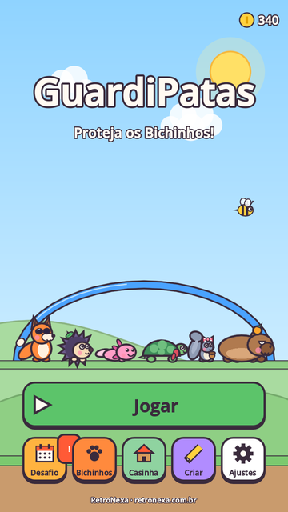 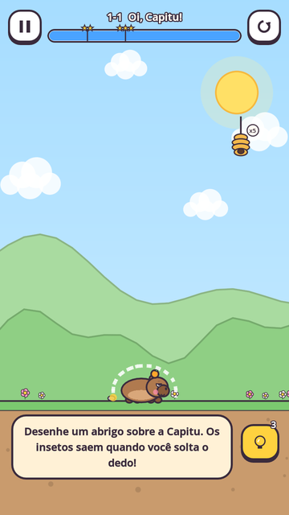 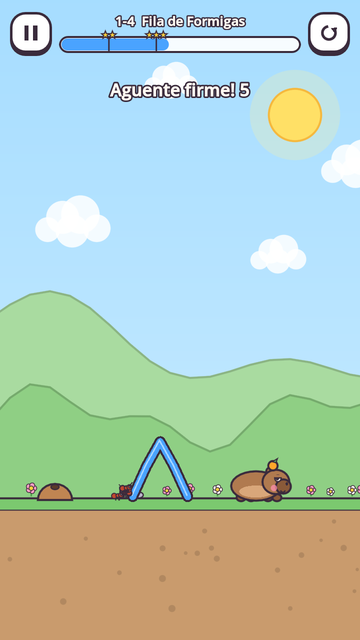 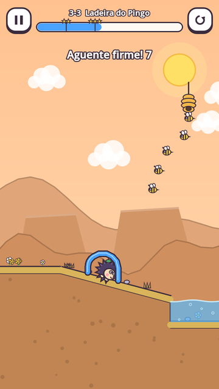

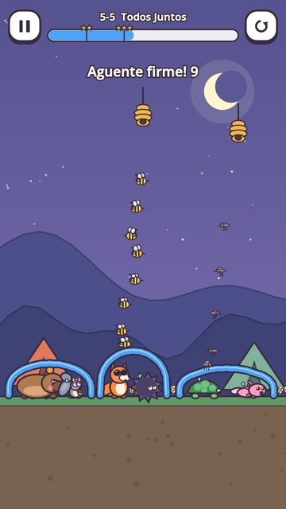 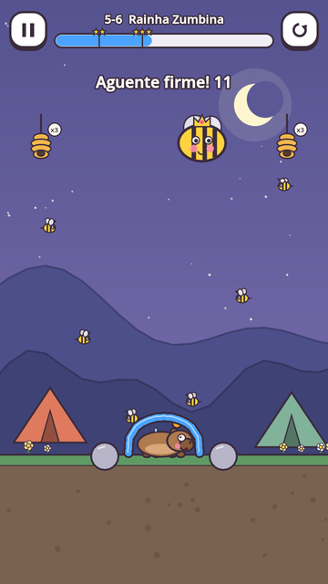 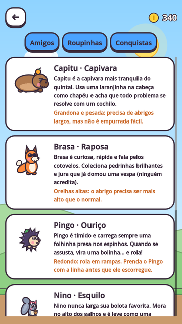 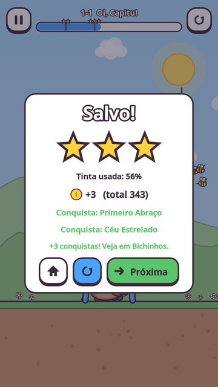

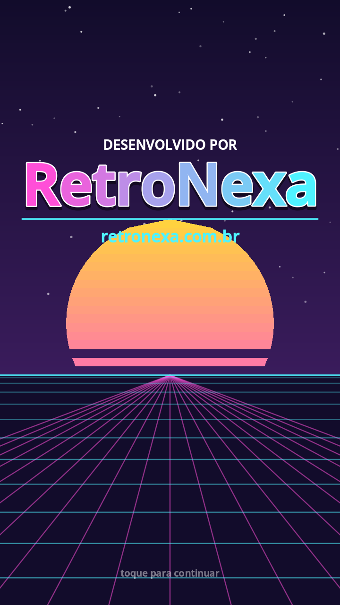 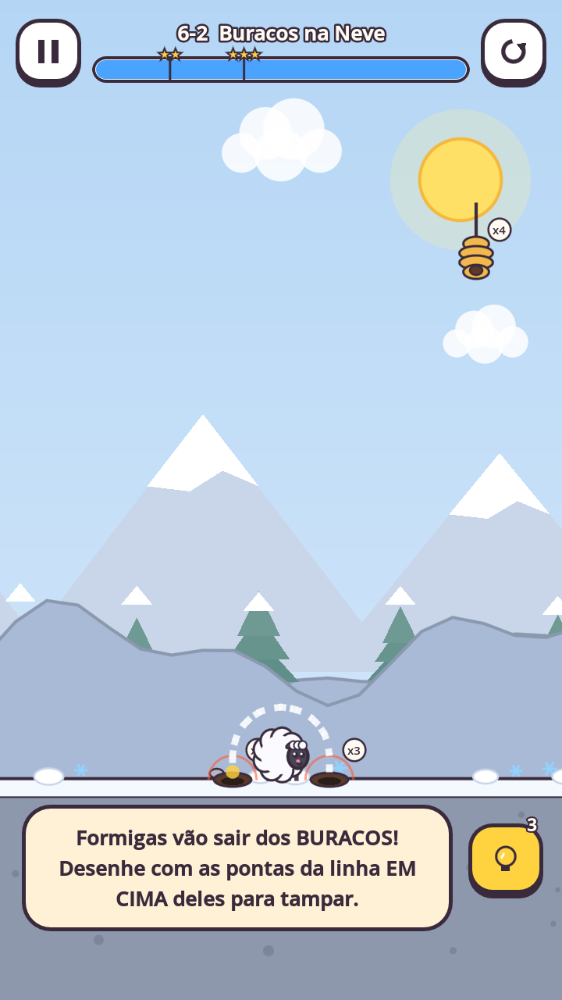 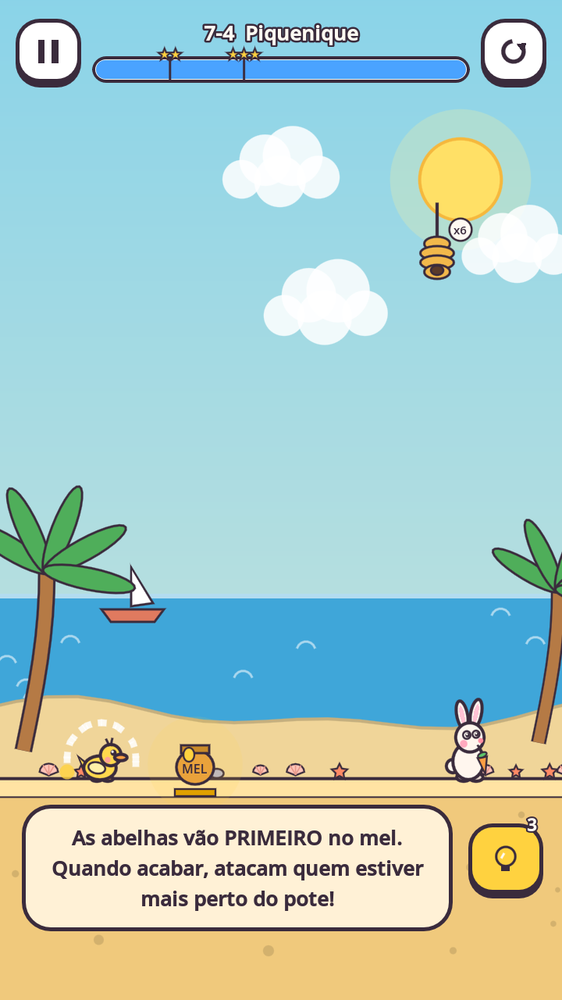 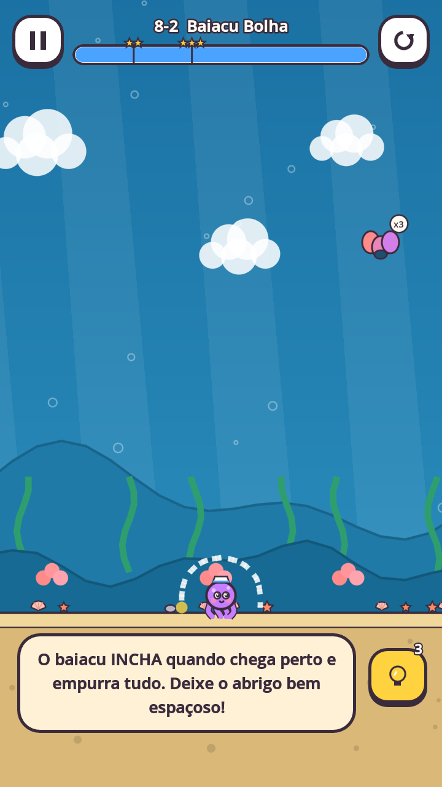

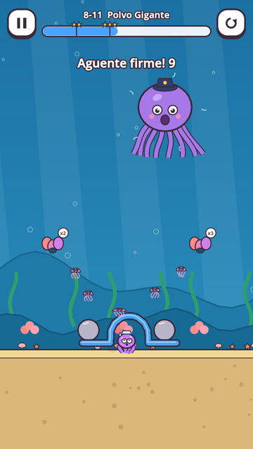 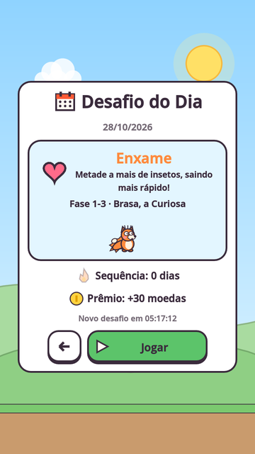 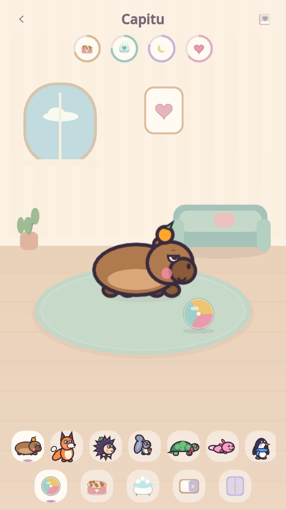 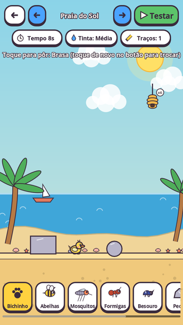

*(capturas reais do jogo renderizadas pelo próprio Godot)*

## Termos de Uso e Política de Privacidade

Termos de Uso, Política de Privacidade conforme a **LGPD**, "Seus direitos" (com o que está salvo no aparelho) e um guia para responsáveis, em PT/EN/ES, nos Ajustes e no aviso de aceite da primeira abertura. A RetroNexa aparece como desenvolvedora. As páginas para a Play Console ficam em `docs/site/`. Veja o [doc 26](docs/26-termos-e-privacidade.md).

## Versão 1.0: 123 fases, Modo Infinito e muito mais

**Modo Infinito** com fases geradas sem parar (cada uma é simulada escondida antes de aparecer, então sempre tem solução), **4 mundos novos** (Cidade dos Brinquedos, Nuvens Altas, Deserto das Dunas e Castelo Assombrado), 5 bichinhos e 7 insetos novos, **tutorial jogável** quando um inseto aparece pela primeira vez, **369 missões extras**, petiscos e banho de bolhas na Casinha, e a campanha numerada de 1 a 123. Veja [o que mudou](docs/25-versao-1-0-infinito-mundos-missoes.md).

## Versão 0.8: 83 fases, novos insetos, loja cheia e editor refeito

**Mundo 9 — Bosque dos Vagalumes** e **Mundo 10 — Vulcão Fumegante**: 20 fases novas, bem mais difíceis, com 6 insetos que têm poderes próprios (Vagalume que acelera o enxame, Mosca que se divide, Cigarra que empurra a linha com som, Besouro Pum-Pum que lança fumaça em arco, Louva-a-deus que levanta a linha e Formiga Tesoura que corta a tinta) e 3 bichinhos novos (Zeca, Mel e Fiapo). O editor agora cabe em qualquer celular e mostra todos os bichinhos e insetos; a tela inicial ficou mais limpa, com bichinhos passando. A Loja ganhou abas, 4 bichinhos mágicos com efeitos especiais, 8 efeitos e 18 produtos. Veja [o que mudou, como testar e o que falta para compras reais](docs/23-versao-0-8-mundos-loja-editor.md).

## Campanha 0.4: mais estratégia

As 63 fases foram rebalanceadas: ninhos nos apoios, cavernas com duas entradas, camadas contra brocas, rampas até as tocas e ancoragem contra vento. As duas primeiras ensinam o desenho; depois é preciso ler o cenário e administrar a tinta. Os objetivos iniciais não mostram mais a receita da solução. Veja [o que mudou e como testar](docs/18-estrategia-e-dificuldade.md).

## Pressão 0.7: insetos mais fortes

Enxames mais densos, mosquitos mais rápidos, investidas de vespa mais pesadas e brocas que perfuram em 1,6 s. As saídas precisam de cobertura dos dois lados e mostram a proteção parcial. Quatro fases agora exigem três camadas independentes. A IA contorna o pote vazio e tenta outro caminho quando um canto fica bloqueado. Veja [mudanças e testes](docs/22-pressao-e-defesas.md).

## Reveja onde falhou

Depois de perder, **Ver onde falhou** mostra uma revisão visual dos últimos três segundos, com o local da derrota, câmera lenta e controle para arrastar o histórico. O recurso é gratuito e ajuda a comparar o movimento dos insetos com os apoios e as saídas. Veja [como usar e testar](docs/21-revisao-das-tentativas.md).

## Planejamento 0.6 e novos ajustes

As 63 fases agora exigem planejamento desde o começo, com orçamento mais apertado e 50 saídas adicionais para proteger separadamente. Plataformas móveis carregam suas saídas; resgates exigem sustentar a chegada. Os ajustes ganharam cartões, interruptores e listas de opções com layout responsivo. Veja [mudanças e validação](docs/20-planejamento-e-ajustes.md).

## Insetos 0.5: novas táticas

Abelhas e mosquitos procuram passagens e alvos expostos. Besouros e caranguejos preparam golpes contra tinta solta; vespas mostram a direção da investida; grilos escolhem quando saltar; aranhas recolhem o fio para tentar outra descida. Brocas exibem o progresso da perfuração e baiacus inflam ao pressionar barreiras. Cinco fases receberam combinações dessas ameaças. Veja [como funcionam e como testar](docs/19-insetos-taticas.md).

## Cuidados na Casinha

Cinco ambientes ilustrados: sala, cozinha, banheiro, quarto e guarda-roupa. Arraste alimentos e sabão até o bichinho, toque na cama para dormir e lance uma bola com gravidade e quique. Retratos e acessórios ficam em carrosséis; pequenos indicadores mostram as necessidades de cada amigo. Os cuidados são gratuitos e ficam pausados fora da Casinha. Veja [como brincar e testar](docs/17-casinha-cuidados.md).

## Loja em fase de teste

A versão de desenvolvimento possui **compras simuladas, sem cobrança**: 3 pacotes de moedas, kit de boas-vindas, 3 novos companheiros da Casinha (Amora, Bambu e Gotinha) e 6 novos acessórios. Abra **Lojinha · teste** no menu. A simulação é recusada em release e usa progresso separado. A campanha permanece gratuita.

**Não publicar com compras reais ainda.** Consulte a [revisão de segurança e os requisitos de publicação](docs/16-publicacao-seguranca-e-compras.md) antes de integrar Google Play Billing ou preencher a Play Console. Não há API de pagamento real nesta entrega.

## O que já tem
- **123 fases em 14 mundos** (Jardim, Floresta, Vale das Formigas, Lagoa, Acampamento, Montanha Gelada, Praia do Sol, Fundo do Mar, Bosque dos Vagalumes, Vulcão Fumegante, **Cidade dos Brinquedos, Nuvens Altas, Deserto das Dunas e Castelo Assombrado**) + **Modo Infinito** + **4 chefões sem violência**: Rainha Zumbina, Coruja Nevasca, Caranguejo Rei e Polvo Gigante.
- **Estratégia de verdade:** buracos para tampar, Tinta Firme para rampas e tobogãs, tocas de destino, abelha que fura a linha, iscas de mel, cocos caindo, vento e correnteza — e o teste automático garante que o **círculo genérico perde** nessas fases.
- **17 bichinhos** originais com traços de física próprios — Capitu, Brasa, Pingo, Nino, Tuca, Lulu, Gelinho (pinguim que escorrega), Nuvem (ovelha de lã grossa), Kiko (coala), Tatá (tatu-bola que rola), Pompom (coelho), Patinha (pato), Fofa (foca), Tito (polvo), **Zeca (sapo), Mel (ursinha) e Fiapo (bicho-preguiça)** — **cada um com seu próprio jeito e som de susto**.
- **21 criaturas** com regras diferentes: abelha, formiga, besouro, mosquito, vespa, mariposa, cupim, lagarta, grilo, abelha broca, aranha, caranguejo, água-viva, baiacu, Baiacu-broca e **Vagalume, Mosca Gêmea, Cigarra, Besouro Pum-Pum, Louva-a-deus e Formiga Tesoura**.
- **Modo Livre** com tinta infinita nas fases já vencidas, **57 conquistas**, 15 acessórios e abertura com o logo da **RetroNexa**.
- **Desafio do Dia**, **medalhas extras** (Pegada Dourada, De Primeira, Relâmpago), **Casinha da Turma**, **Álbum de fotos** das vitórias e **editor de fases**.
- **Português, inglês e espanhol**, texto grande e correção de cores para daltonismo.
- Trilha própria para cada mundo + música de chefão; ícone adaptativo; materiais da Play Store prontos ([docs/15](docs/15-loja-google-play.md)).
- Linha com **peso real** (corpo rígido de cápsulas), validação do traço por física, tinta limitada com metas de estrela visíveis, caixas, lâmpadas, água, plataformas móveis, zonas proibidas.
- Menus, mapa, coleção com histórias, **guarda-roupa cosmético**, conquistas, dicas, ajustes de acessibilidade (alto contraste, reduzir movimento), salvamento local, botão voltar do Android.
- **Dezenas de efeitos sonoros + músicas** sintetizados do zero (`tools/gen_audio.py`).
- **Testes automáticos**: cada fase é desenhada com a solução registrada e simulada — tem que vencer; e sem linha tem que perder. Nas 63 fases, oito padrões genéricos precisam perder; as provas de camadas também verificam a omissão de cada traço. **Mais de 400 verificações da campanha**, 516 verificações contra padrões genéricos e camadas, 200 combinações de desafios diários e teste de fluxo da interface, sem falhas.
- **Sem anúncios, sem cobranças reais, sem coleta de dados** nesta versão (monetização planejada com ética no doc 11).

## Rodar
1. Instale o **Godot 4.7.2** e importe `project.godot`.
2. **F5** — o mouse faz o papel do dedo.
3. Depois de concluir o desenho, toque em **Velocidade: 1×** para acelerar a simulação em **2×**. Toque novamente para voltar. Pausar, vencer, perder ou sair restaura a velocidade normal; a física mantém o mesmo passo de simulação.

Testes: `godot --headless --fixed-fps 60 --path . res://tests/test_runner.tscn` · Exportar para Android e publicar: [docs/14](docs/14-como-rodar-e-publicar.md).

## Documentação (primeira entrega)
| # | Documento |
|---|---|
| 01 | [Resumo executivo](docs/01-resumo-executivo.md) |
| 02 | [Pesquisa tecnológica, comparação Unity × Godot × Defold, fontes e recomendação](docs/02-pesquisa-tecnologica.md) |
| 03 | [Identidade visual](docs/03-identidade-visual.md) |
| 04 | [Som e música](docs/04-audio.md) |
| 05 | [Ficha dos 14 bichinhos](docs/05-personagens.md) |
| 06 | [Ficha dos insetos](docs/06-insetos.md) |
| 07 | [Mecânicas e regras de física](docs/07-mecanicas-e-fisica.md) |
| 08 | [As 63 fases (cenário, objetivo, perigos, mecânica, solução)](docs/08-fases.md) |
| 09 | [Arquitetura técnica e decisões](docs/09-arquitetura.md) |
| 10 | [Progressão, recompensas e acessibilidade](docs/10-progressao-e-acessibilidade.md) |
| 11 | [Monetização, privacidade e classificação](docs/11-monetizacao-e-privacidade.md) |
| 12 | [Plano de desenvolvimento, o que foi testado e o que falta](docs/12-plano-de-desenvolvimento.md) |
| 13 | [Riscos técnicos e mitigação](docs/13-riscos.md) |
| 14 | [Como rodar, testar, exportar e publicar](docs/14-como-rodar-e-publicar.md) |
| 15 | [Loja: textos PT/EN/ES, imagens, formulários e privacidade](docs/15-loja-google-play.md) |
| 26 | [Termos de Uso, Política de Privacidade (LGPD) e Google Play](docs/26-termos-e-privacidade.md) |
| 25 | [Versão 1.0: Modo Infinito, mundos 11–14, missões, tutoriais e petiscos](docs/25-versao-1-0-infinito-mundos-missoes.md) |
| 24 | [Versão 0.9: rolagem, pausa ilustrada, prévias e dificuldade](docs/24-versao-0-9-pausa-previas-dificuldade.md) |
| 23 | [Versão 0.8: editor, tela inicial, mundos 9–10, novos insetos, loja e compras reais](docs/23-versao-0-8-mundos-loja-editor.md) |

## Decisão técnica
**Godot 4.7.2 + GDScript.** A mecânica central — criar um corpo físico de forma livre a cada tentativa e validar o traço contra o cenário — é natural no Godot; ele roda **headless com passo fixo**, o que permite testar automaticamente se cada fase é solucionável; é **MIT, sem royalties**, leve para celulares modestos e guarda cenas/dados em texto. Detalhes e fontes no [doc 02](docs/02-pesquisa-tecnologica.md).
