# GuardiPatas — Proteja os Bichinhos 🐾

Puzzle de física 2D para Android: **desenhe uma linha com o dedo** para proteger bichinhos fofos de insetos travessos. Solte o dedo, a física começa, os insetos saem dos ninhos — e o seu abrigo tem que aguentar até o cronômetro zerar.

Feito em **Godot 4.7.2 (GDScript)**, renderizador Compatibility, para todas as idades.

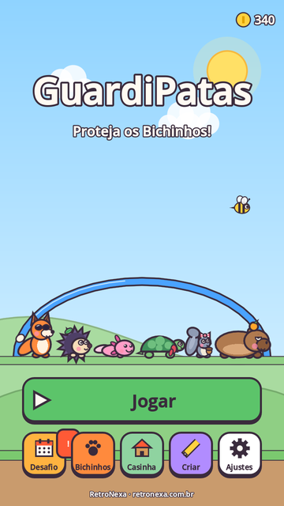 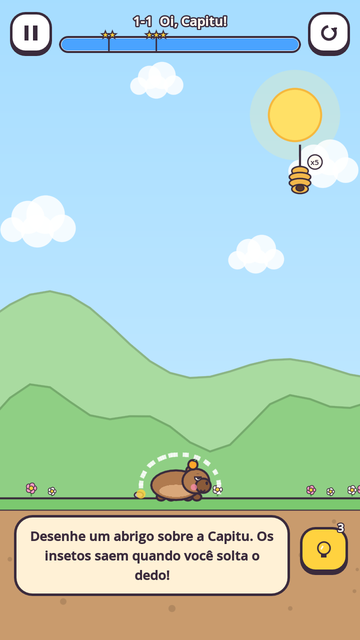 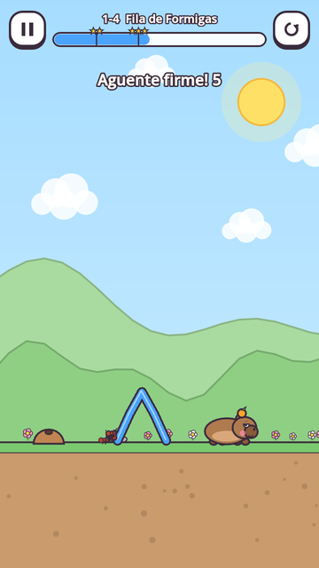 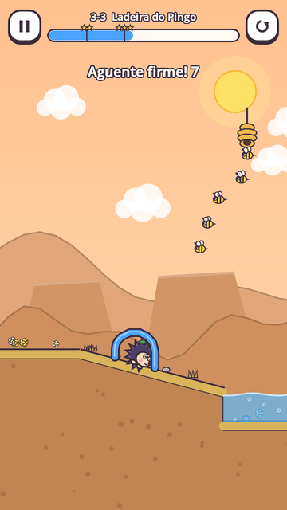

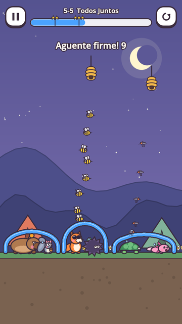 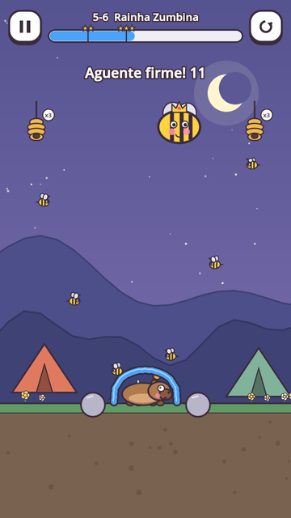 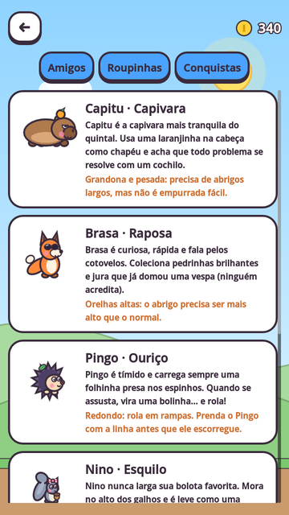 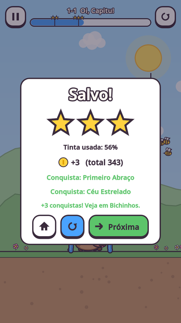

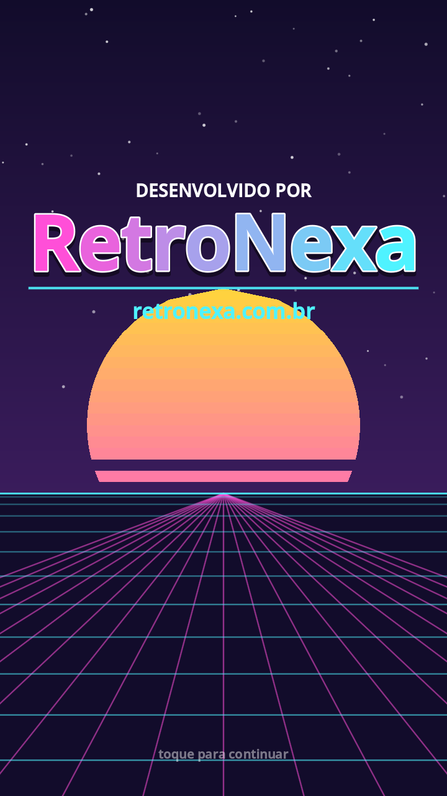   

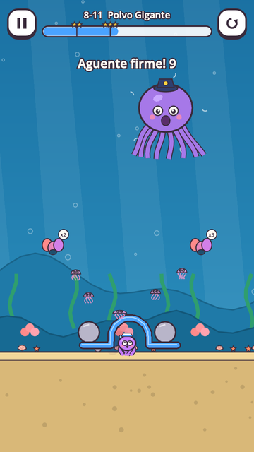 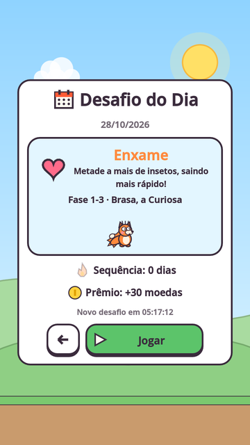 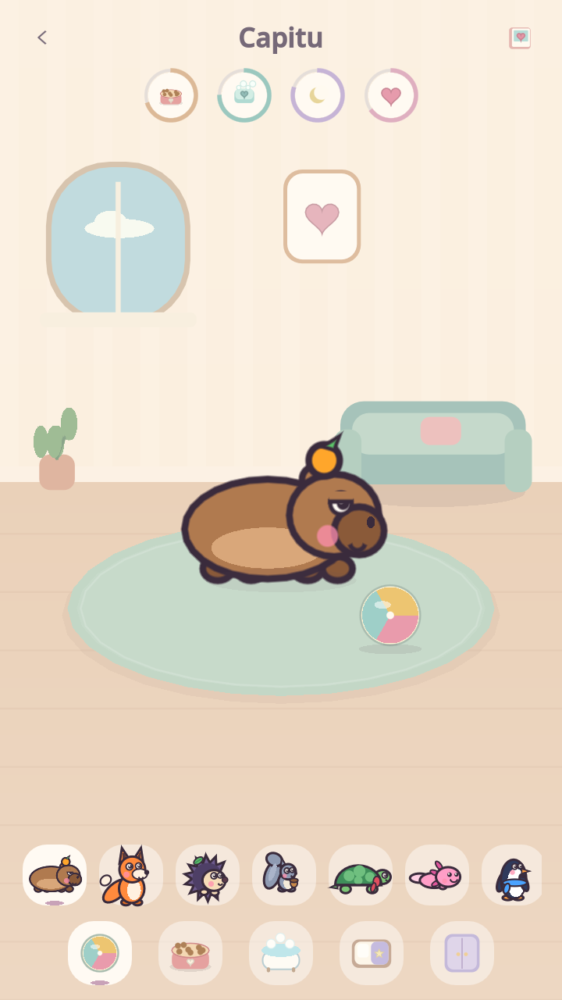 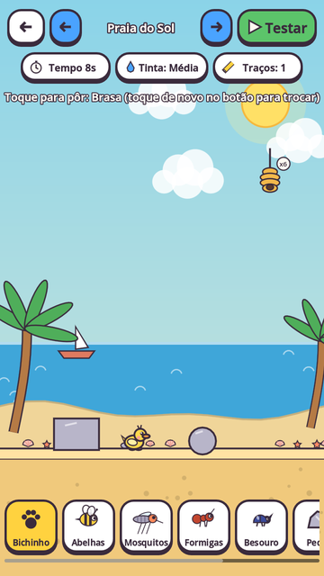

*(capturas reais do jogo renderizadas pelo próprio Godot)*

## Cuidados na Casinha

Alimente, dê banho com sabão e enxágue, coloque para dormir, jogue bola e experimente roupas. Cada bichinho tem barrinhas próprias de comida, higiene, energia e carinho. Os cuidados são gratuitos e ficam pausados fora da Casinha. Veja [como brincar e testar](docs/17-casinha-cuidados.md).

## Loja em fase de teste

A versão de desenvolvimento possui **compras simuladas, sem cobrança**: 3 pacotes de moedas, kit de boas-vindas, 3 novos companheiros da Casinha (Amora, Bambu e Gotinha) e 6 novos acessórios. Abra **Lojinha · teste** no menu. A simulação é recusada em release e usa progresso separado. A campanha permanece gratuita.

**Não publicar com compras reais ainda.** Consulte a [revisão de segurança e os requisitos de publicação](docs/16-publicacao-seguranca-e-compras.md) antes de integrar Google Play Billing ou preencher a Play Console. Não há API de pagamento real nesta entrega.

## O que já tem
- **63 fases em 8 mundos** (Jardim, Floresta, Vale das Formigas, Lagoa, Acampamento, **Montanha Gelada, Praia do Sol, Fundo do Mar**) + **4 chefões sem violência**: Rainha Zumbina, Coruja Nevasca, Caranguejo Rei e Polvo Gigante.
- **Estratégia de verdade:** buracos para tampar, Tinta Firme para rampas e tobogãs, tocas de destino, abelha que fura a linha, iscas de mel, cocos caindo, vento e correnteza — e o teste automático garante que o **círculo genérico perde** nessas fases.
- **14 bichinhos** originais com traços de física próprios — Capitu, Brasa, Pingo, Nino, Tuca, Lulu, Gelinho (pinguim que escorrega), Nuvem (ovelha de lã grossa), Kiko (coala), Tatá (tatu-bola que rola), Pompom (coelho), Patinha (pato), Fofa (foca) e Tito (polvo) — **cada um com seu próprio jeito e som de susto**.
- **14 criaturas** com regras diferentes: abelha, formiga, besouro, mosquito, vespa, mariposa, cupim, lagarta, grilo, abelha broca, aranha, caranguejo, água-viva e baiacu.
- **Modo Livre** com tinta infinita nas fases já vencidas, **57 conquistas**, 15 acessórios e abertura com o logo da **RetroNexa**.
- **Desafio do Dia**, **medalhas extras** (Pegada Dourada, De Primeira, Relâmpago), **Casinha da Turma**, **Álbum de fotos** das vitórias e **editor de fases**.
- **Português, inglês e espanhol**, texto grande e correção de cores para daltonismo.
- Trilha própria para cada mundo + música de chefão; ícone adaptativo; materiais da Play Store prontos ([docs/15](docs/15-loja-google-play.md)).
- Linha com **peso real** (corpo rígido de cápsulas), validação do traço por física, tinta limitada com metas de estrela visíveis, caixas, lâmpadas, água, plataformas móveis, zonas proibidas.
- Menus, mapa, coleção com histórias, **guarda-roupa cosmético**, conquistas, dicas, ajustes de acessibilidade (alto contraste, reduzir movimento), salvamento local, botão voltar do Android.
- **Dezenas de efeitos sonoros + músicas** sintetizados do zero (`tools/gen_audio.py`).
- **Testes automáticos**: cada fase é desenhada com a solução registrada e simulada — tem que vencer; e sem linha tem que perder. Nas fases de estratégia, a solução ingênua (círculo) tem que perder. **405 verificações** + teste de fluxo da interface, 0 falhas.
- **Sem anúncios, sem cobranças reais, sem coleta de dados** nesta versão (monetização planejada com ética no doc 11).

## Rodar
1. Instale o **Godot 4.7.2** e importe `project.godot`.
2. **F5** — o mouse faz o papel do dedo.

Testes: `godot --headless --fixed-fps 60 --path . res://tests/test_runner.tscn` · Exportar para Android e publicar: [docs/14](docs/14-como-rodar-e-publicar.md).

## Documentação (primeira entrega)
| # | Documento |
|---|---|
| 01 | [Resumo executivo](docs/01-resumo-executivo.md) |
| 02 | [Pesquisa tecnológica, comparação Unity × Godot × Defold, fontes e recomendação](docs/02-pesquisa-tecnologica.md) |
| 03 | [Identidade visual](docs/03-identidade-visual.md) |
| 04 | [Som e música](docs/04-audio.md) |
| 05 | [Ficha dos 14 bichinhos](docs/05-personagens.md) |
| 06 | [Ficha dos insetos](docs/06-insetos.md) |
| 07 | [Mecânicas e regras de física](docs/07-mecanicas-e-fisica.md) |
| 08 | [As 63 fases (cenário, objetivo, perigos, mecânica, solução)](docs/08-fases.md) |
| 09 | [Arquitetura técnica e decisões](docs/09-arquitetura.md) |
| 10 | [Progressão, recompensas e acessibilidade](docs/10-progressao-e-acessibilidade.md) |
| 11 | [Monetização, privacidade e classificação](docs/11-monetizacao-e-privacidade.md) |
| 12 | [Plano de desenvolvimento, o que foi testado e o que falta](docs/12-plano-de-desenvolvimento.md) |
| 13 | [Riscos técnicos e mitigação](docs/13-riscos.md) |
| 14 | [Como rodar, testar, exportar e publicar](docs/14-como-rodar-e-publicar.md) |
| 15 | [Loja: textos PT/EN/ES, imagens, formulários e privacidade](docs/15-loja-google-play.md) |

## Decisão técnica
**Godot 4.7.2 + GDScript.** A mecânica central — criar um corpo físico de forma livre a cada tentativa e validar o traço contra o cenário — é natural no Godot; ele roda **headless com passo fixo**, o que permite testar automaticamente se cada fase é solucionável; é **MIT, sem royalties**, leve para celulares modestos e guarda cenas/dados em texto. Detalhes e fontes no [doc 02](docs/02-pesquisa-tecnologica.md).
