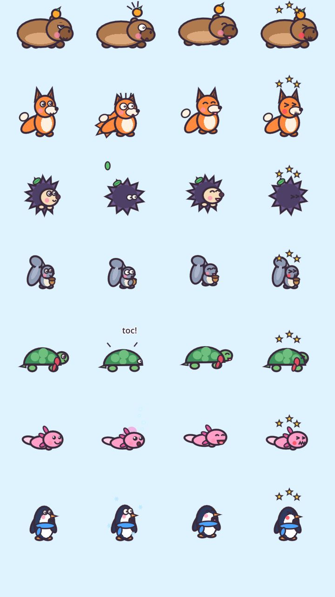
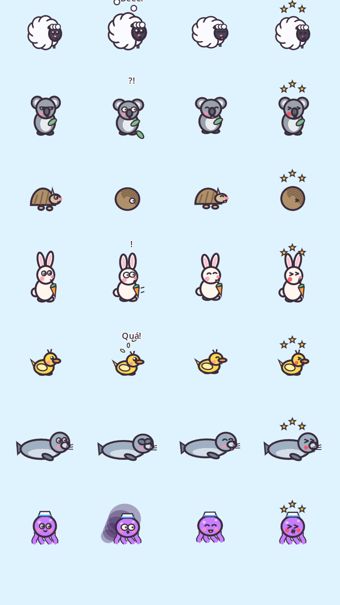

# 05 — Os 14 bichinhos protagonistas

Todos são **originais**. As formas de colisão estão em `src/game/animal.gd` (`SPECIES`) e a arte em `src/game/animal_art.gd`. Animações implementadas para todos: **idle** (respiração + piscadas), **susto** (tremor, olhos arregalados, suor, pupilas seguindo o inseto mais perto), **picadinha** (olhos "><", bochecha vermelha, estrelinhas girando), **comemoração** (pulos com amassadinha), **derrota** (pálpebras caídas, lagriminha).

---

## 1. Capitu — Capivara
- **Silhueta:** "pão" deitado e largo, focinho quadrado, **laranjinha com folha na cabeça**.
- **Paleta:** marrom `#B07A4F`, barriga `#D9A77A`, focinho `#8A5A39`, laranja `#FFA62B`.
- **Personalidade:** zen, preguiçosa, generosa. Fala devagar. Acha que tudo se resolve com um cochilo.
- **Expressões marcantes:** olhos de pálpebra meio fechada (calma total) que **se arregalam** no susto; a laranja **pula da cabeça** quando ela se assusta.
- **História:** Capitu chegou ao quintal boiando numa folha de vitória-régia e decidiu ficar. É a "mãe" informal da turma.
- **Característica de jogo:** **grande e pesada** (massa 4) — precisa de abrigos largos, mas não é empurrada nem por besouros.
- **Reações a insetos:** abelhas → suspira; mosquitos → faz careta (odeia o zumbido); besouros → nem liga.
- **Skins futuras:** capivara de pijama, "Capitu Spa" (toalha + pepino), fruta na cabeça trocável (limão, morango).

## 2. Brasa — Raposa
- **Silhueta:** gota em pé, **orelhas triangulares altas**, cauda enorme com ponta branca que abana.
- **Paleta:** laranja `#FF8A3D`, branco `#FFF1E0`, pontas `#5A3A3A`.
- **Personalidade:** curiosa, rápida, tagarela, um pouco exibida.
- **Expressões:** orelhas **caem** no susto e na tristeza; a cauda abana rápido na comemoração.
- **História:** coleciona pedrinhas brilhantes e jura que já domou uma vespa. Ninguém acredita.
- **Característica:** **alta** (cápsula em pé de 92 px) — o abrigo precisa ser mais alto.
- **Reações:** abelhas → tenta "conversar"; vespas → se esconde atrás da cauda.
- **Skins:** cachecol de aventureira, chapéu de detetive, "Brasa Ártica" (branca).

## 3. Pingo — Ouriço
- **Silhueta:** sol de espinhos lavanda com rostinho creme; **folhinha presa nos espinhos**.
- **Paleta:** espinhos `#6D5A8C`, rosto `#F6DCB8`, nariz `#5A3A4A`, folha `#5CC46A`.
- **Personalidade:** tímido, doce, medroso, leal.
- **Expressões:** no susto **vira uma bola** (só os olhinhos espiando).
- **História:** perdeu-se numa ventania e foi achado pela Capitu dentro de uma bota.
- **Característica:** **redondo e sem trava de rotação → rola em rampas.** Fases com declive exigem prendê-lo com a linha.
- **Reações:** formigas → enrola; mariposas → fica hipnotizado pela luz junto com elas.
- **Skins:** espinhos coloridos (arco-íris), gorrinho de lã, folha de outono.

## 4. Nino — Esquilo
- **Silhueta:** bolinha cinza-azulada com **cauda gigante em "S"** e **bolota nas mãozinhas**.
- **Paleta:** `#8F9BB3`, barriga `#F3EAD8`, bolota `#C98A4A`.
- **Personalidade:** elétrico, otimista, distraído.
- **Expressões:** a cauda chicoteia rápido no susto; abraça a bolota quando triste.
- **História:** guarda bolotas em lugares que esquece; metade das árvores do quintal foi "plantada" por ele.
- **Característica:** **levíssimo (massa 0,6) e mora no alto** — uma linha caindo em cima pode derrubá-lo do galho.
- **Reações:** besouros → sobe no galho mais alto; abelhas → oferece a bolota (não funciona).
- **Skins:** capacete de bolota, óculos de aviador, cauda listrada.

## 5. Tuca — Tartaruga
- **Silhueta:** cúpula verde com placas claras, **cachecol vermelho** com ponta balançando.
- **Paleta:** pele `#7CC576`, casco `#3F8F5A`, placas `#6FBF7F`, cachecol `#E04F5F`.
- **Personalidade:** vovó sábia, paciente, conta histórias longas demais.
- **Expressões:** no susto **recolhe a cabeça** no casco; o casco **brilha** quando bloqueia uma picada.
- **História:** tricota cachecóis para todos; tem 87 anos e "já viu de tudo, até um besouro educado".
- **Característica:** **casco aguenta UMA picada** (o inseto quica e fica tonto). Nada, então água não a derrota.
- **Reações:** mosquitos → "no meu tempo eles eram maiores".
- **Skins:** casco pintado de joaninha, óculos de leitura, gorro de tricô.

## 6. Lulu — Axolote
- **Silhueta:** cápsula rosa deitada com **três brânquias frisadas** de cada lado e sorriso enorme.
- **Paleta:** `#FF9EC7`, brânquias `#E0569B`, cauda `#FFD0E4`.
- **Personalidade:** alegre, cantora, faz amizade com todo mundo (até com mosquitos).
- **Expressões:** brânquias **eriçam** no susto; faz bolhas na comemoração.
- **História:** mora num aquário de vidro no quintal e é a DJ das festas da turma.
- **Característica:** **vive na água** — insetos que mergulham são levados embora; só os voadores que vêm por cima são perigo.
- **Reações:** formigas → ri (elas não nadam); vespas → mergulha.
- **Skins:** coroa de bolhas, óculos de mergulho, brânquias neon.

---

## A turma nova (mundos 6–8)

 

*(colunas: parado · **assustado** · feliz · picadinha)*

| # | Nome | Espécie | Corpo / física | Personalidade e história | Característica de jogo |
|---|---|---|---|---|---|
| 7 | **Gelinho** | Pinguim | cápsula em pé r22 h72, massa 1,4, **atrito 0,05**, nada | Desceu da montanha de barriga e nunca mais quis andar. Cachecol tricotado pela Tuca. | **Escorrega**: um empurrão e ele desliza — nas fases de toca vira "tobogã" |
| 8 | **Nuvem** | Ovelha | círculo r32, massa 2,2 | Tão fofa que passarinhos tentam fazer ninho nela; conta estrelas e perde a conta. | **Lã grossa: aguenta 2 picadinhas** |
| 9 | **Kiko** | Coala | cápsula r24 h76, massa 0,7 | Dorme 20 h por dia; as outras 4 procura o eucalipto perfeito. | Levinho e sonolento (pálpebras caídas) |
| 10 | **Tatá** | Tatu-bola | círculo r24, massa 1,6, **rola** | Diz que rolar ladeira abaixo é esporte. | Rola: leve-o até a toca com uma rampa de Tinta Firme |
| 11 | **Pompom** | Coelho | cápsula r22 **h84**, massa 0,8 | Nunca solta a cenoura da sorte; o mais rápido e o mais medroso. | Orelhas compridas: abrigo bem alto |
| 12 | **Patinha** | Pato | círculo r22, massa 0,5, nada | Nada desde que saiu do ovo; faz "quá" quando está feliz. | Levinha e nadadora |
| 13 | **Fofa** | Foca | cápsula deitada r24 **h100**, massa 3, nada | Equilibra qualquer coisa no nariz (até a laranja da Capitu). | Grandona: abrigo comprido |
| 14 | **Tito** | Polvo | círculo r24, massa 1, nada | Marinheiro do fundo do mar; usa os oito braços para abraçar. | Vive no mar: águas-vivas e baiacus |

## Cada um se assusta do seu jeito
Quando um inseto chega perto (210 px), além do tremor, olhos arregalados e suor, **cada bichinho tem uma reação e uma voz próprias** (`_draw_scare_back/_front/_text` em `animal_art.gd`, `SCARE_VOICE` em `animal.gd`; tudo respeita "Reduzir movimento"):

| Bichinho | Reação visual | Som |
|---|---|---|
| Capitu | Dá um pulinho e a **laranja salta** com risquinhos de susto | suspiro grave |
| Brasa | **Cauda arrepiada** (espinhos de pelo) e topete em pé, orelhas murcham | suspiro agudo |
| Pingo | Vira bolinha e a **folhinha voa** dos espinhos | suspiro bem agudo |
| Nino | **Abraça a bolota** tremendo | suspiro fininho |
| Tuca | Esconde a cabeça; o casco treme fazendo **"toc!"** | suspiro bem grave |
| Lulu | **Brânquias brilham** e solta bolhas rápidas | "blup" |
| Gelinho | Estica o corpo e **floquinhos de neve** giram em volta | suspiro |
| Nuvem | A lã **incha** como pipoca, solta tufinhos e grita **"Bééé!"** | balido |
| Kiko | Acorda de olhos arregalados (**"?!"**) e a folha de eucalipto cai | suspiro |
| Tatá | Fecha-se em bola e **balança** | suspiro |
| Pompom | **Orelhas em pé**, pulinhos nervosos, cenoura tremendo, "!" | suspiro agudíssimo |
| Patinha | **Peninhas voando** e um **"Quá!"** | "quá" |
| Fofa | **Tapa os olhos** com as nadadeiras (espiando) | suspiro grave |
| Tito | Solta uma **nuvem de tinta** que se espalha e some | "blup" grave |

## Cosméticos já implementados (todas as espécies)
Boné listrado · Laço de bolinhas · Óculos de sol · Chapéu de palha · Presilha estrela-do-mar · Coroa de flores · Cachecol quentinho · Touca de lã · Coroa dourada — comprados com moedas do jogo, **apenas visuais**.
