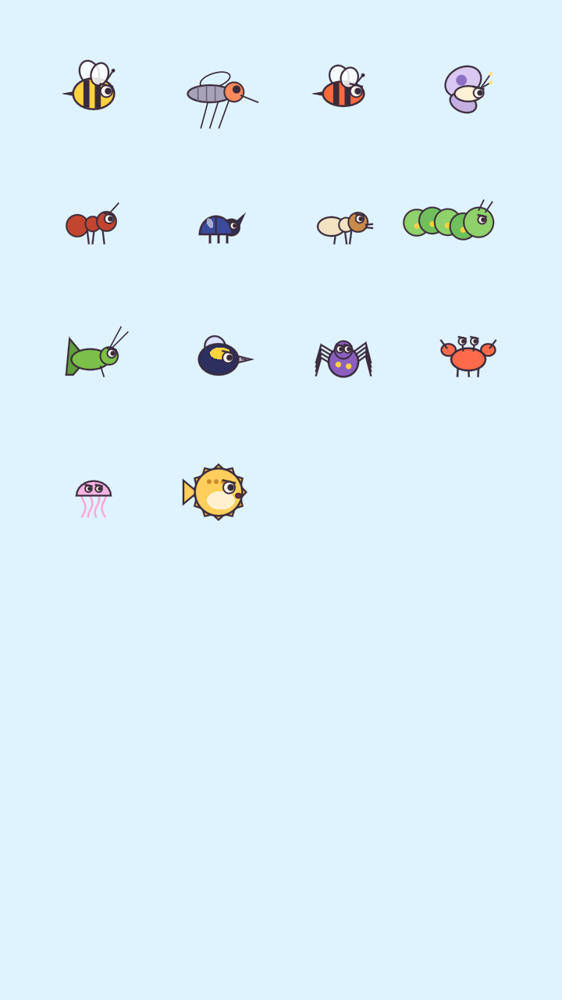

# 06 — Insetos e ameaças

**Regras de justiça (valem para todos):**
1. O ninho de onde o inseto sai **é visível** e mostra **quantos** ainda vão sair (`x5`).
2. Velocidade máxima fixa e comportamento determinado pelas regras abaixo — **nenhum sorteio decide a fase**. O único ruído é um zigue-zague estético.
3. Todo inseto tem **uma forma clara de ser bloqueado**, deduzível pela aparência.
4. Ninguém morre: no fim da fase eles **desistem** (voam embora / cochilam); a água os **leva boiando**.

Implementação: `src/game/insects/*.gd` (base `Insect`, comportamento em `_behave()`).

| # | Nome | Velocidade | Movimento | Ponto forte | Limitação | Como bloquear | Estado |
|---|---|---|---|---|---|---|---|
| 1 | **Abelha Zumbi** | 230 px/s | Voa direto ao bichinho mais próximo, com zigue-zague; ao ser segurada, **desliza pela barreira** procurando brecha | Insistente; contorna | Empurra pouco (massa 0,15) | Abrigo fechado e apoiado | ✅ |
| 2 | **Formiga Tilim** | 95 px/s | Anda em **fila** pelo chão; sobe **degraus ≤ 18 px** e rampas suaves; não colide com as colegas | Vem em grupo, contorna obstáculos baixos | Não voa, não sobe paredes íngremes, não nada | Parede "Λ" íngreme, vala, água | ✅ |
| 3 | **Besouro Bolota** | 60 px/s | Anda pelo chão e **empurra** (força até 1100) | Desloca linhas leves e caixas | Lento, não escala, não voa | Barreira **pesada** (mais tinta) ou travada no terreno | ✅ |
| 4 | **Mosquito Zizi** | 300 px/s | Voo rápido e errático; desliza forte procurando fresta | Passa por qualquer brecha > 14 px | Quase não empurra (massa 0,05) | Abrigo **sem frestas** | ✅ |
| 5 | **Vespa Faísca** | 200 px/s + investida 820 px/s | Aproxima-se até 260 px, **mira 0,7 s com "!" piscando** e investe em linha reta; depois fica tonta 0,9 s | Impacto forte, empurra a linha | Telegrafa o ataque; após a investida fica vulnerável | Barreira apoiada no chão / pesada; prever o ângulo pelo "!" | ✅ |
| 6 | **Mariposa Lumi** | 150 px/s | **Orbita a lâmpada acesa** mais próxima; quando apaga (contador visível), vai devagar ao bichinho | Muda de alvo | Lenta, fraca | Proteger para o momento em que a luz apagar; usar a luz como isca | ✅ |
| 7 | **Cupim Roque-Roque** | 55 px/s | Vai até a **caixa/tábua de madeira** mais próxima (até 420 px) e a rói: rachaduras aparecem e ela quebra após 1,6 s de roída acumulada | Destrói barreiras de madeira | Não afeta a linha de tinta nem pedra | Não confiar só em madeira; abrigo de tinta | ✅ |
| 8 | **Lagarta Gulosa** | 42 px/s | Anda pelo chão e **sobe qualquer parede** (terreno, caixa ou a sua linha), descendo do outro lado | Paredes e tendas não a seguram | Muito lenta; não voa; água a leva | **Abrigo fechado** (arco) ou água | ✅ |

| 9 | **Grilo Saltitante** | anda + **pulo** | Anda e, perto de uma parede, **pula por cima** | Parede/tenda não bastam | Não fura nem empurra | Abrigo **com teto** | ✅ |
| 10 | **Abelha Broca** | 220 px/s | Voa até a linha e, encostada nela por **2,2 s acumulados**, **fura um buraco** (marca visível) | Atravessa uma parede simples | Precisa ficar parada furando | **Parede dupla** (dois traços) | ✅ |
| 11 | **Aranha Fiandeira** | anda no teto | Anda pelo alto até ficar acima do bichinho e **desce reto pelo fio** | Vem de cima, onde ninguém olha | Só desce na vertical | **Teto** firme | ✅ |
| 12 | **Caranguejo Belisco** | anda | Sai das **tocas na areia**, anda de lado e **empurra forte** (650); **não tem medo de água** | Mora em buracos, empurra | Lento | **Tampar a toca** com a ponta da linha, ou abrigo pesado | ✅ |
| 13 | **Água-viva Gelatina** | pulsos | Nada em **pulsos lentos** (0,9 s) até o bichinho | Muitas de uma vez | Lenta, fraca | Abrigo sem frestas; a correnteza a desvia | ✅ |
| 14 | **Baiacu Bolha** | nada | Perto do alvo **incha** (raio 13 → 27) e empurra tudo | Cresce dentro de frestas | Murcha de novo | Abrigo **espaçoso** | ✅ |

**Ninhos e tocas:** colmeia, formigueiro, teia, coral e **buraco/toca** (14 tipos de ninho). Um buraco **tampado** por linha ou caixa (raio 10 px) não solta mais ninguém — aparece "Tampado!".

### Chefona (sem violência) ✅
**Rainha Zumbina** — abelha-rainha gigante (fase 5-6) que **não pica**: paira indo de um lado ao outro e, a cada 3,2 s, **infla as bochechas** (aviso de 1 s com "!") e **sopra** uma rajada que empurra linhas, caixas e bichinhos para longe dela (e deixa as operárias tontas). Vence-se aguentando 14 s com um abrigo travado entre duas pedras. (Implementação: `src/game/insects/queen_bee.gd`.)

### Chefões dos mundos 6–8 ✅ (`src/game/insects/boss.gd`)
Todos avisam 1 s antes de agir (ícone "!" piscando + marcação na tela) e ninguém se machuca:
- **Coruja Nevasca** (6-11): pousada num galho, levanta as asas e derruba **bolas de neve** nos **X** marcados no chão (perto do bichinho, alternando dois lados / centro). Neve que acerta o bichinho = "Bonk de neve!". As bolas de neve ficam numa camada própria de colisão: não "atiram" abelhas através da linha.
- **Caranguejo Rei** (7-11): anda de lado na areia, levanta a garra mostrando o **arco pontilhado** e arremessa uma **concha** no bichinho mais perto. Os caranguejinhos saem das tocas.
- **Polvo Gigante** (8-11): incha (aviso) e por 1,4 s **suga** linhas e caixas na direção dele (insetos sentem só um pouco); depois solta uma nuvem de tinta, só visual. Se um bichinho chegar até ele: "Abraço apertado!". Bloqueio justo: passar as pontas do abrigo por baixo das pedras.

### Progressão da dificuldade
Mundo 1: abelha → formiga → abelha+formiga. Mundo 2: mosquito, mariposa+luz, vários bichinhos, dois traços. Mundo 3: besouro, abismos, plataformas móveis, cupim. Mundo 4: água, Lulu e Tuca, vespa, lagarta. Mundo 5: noite, lâmpadas como isca, combinações e chefão. Mundo 6 (Montanha): buracos, grilos, aranha, abelha broca, vento, Tinta Firme. Mundo 7 (Praia): caranguejos nas tocas, coco caindo, isca de mel, vespas. Mundo 8 (Mar): águas-vivas, baiacus, correnteza, caranguejos do fundo.

## Baiacu-broca (campanha 0.4)

Aparece em tocas no coral e nos apoios submarinos. Tem corpo de baiacu com uma ponta de broca, resiste à água e perfura cada corpo de linha após 2,2 segundos de contato acumulado, como a abelha-broca. Pedras continuam bloqueando-o. A resposta estratégica é tampar a saída no apoio ou usar camadas independentes e espaçadas. A toca mostra o símbolo de broca antes do início da simulação.

Abelhas-broca e baiacus-broca contornam o canto superior das pedras quando a rota direta está bloqueada. O movimento continua físico, com velocidade limitada: não teleportam nem atravessam terreno.
