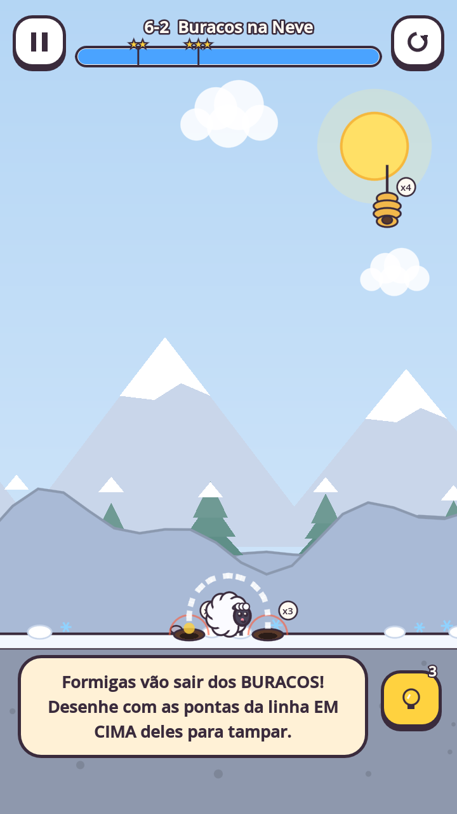
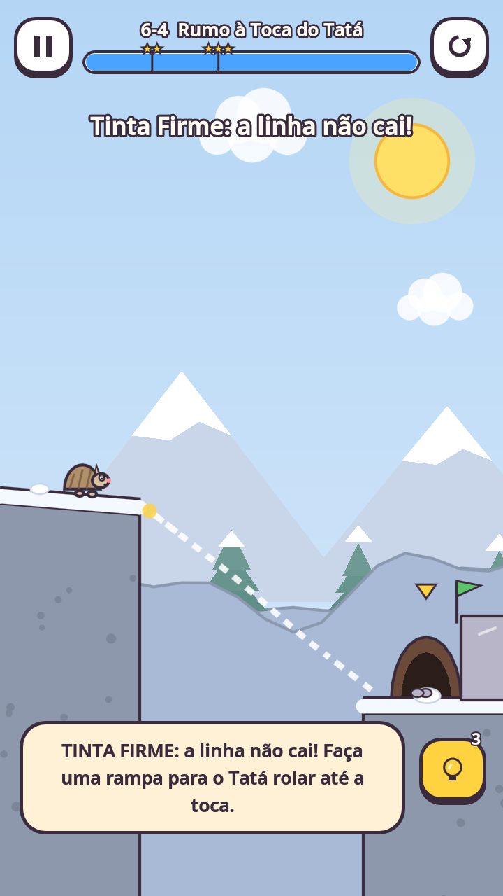
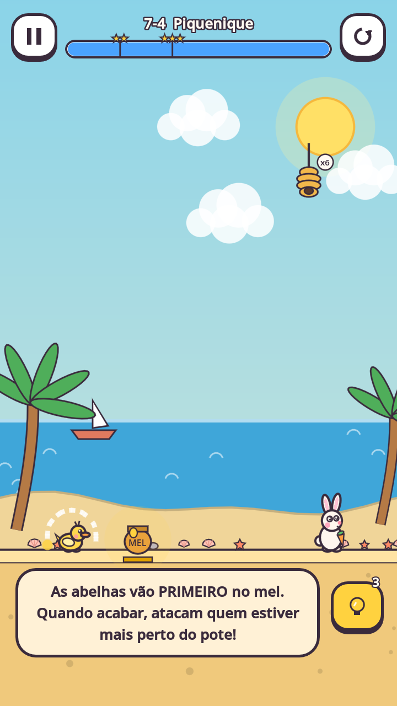
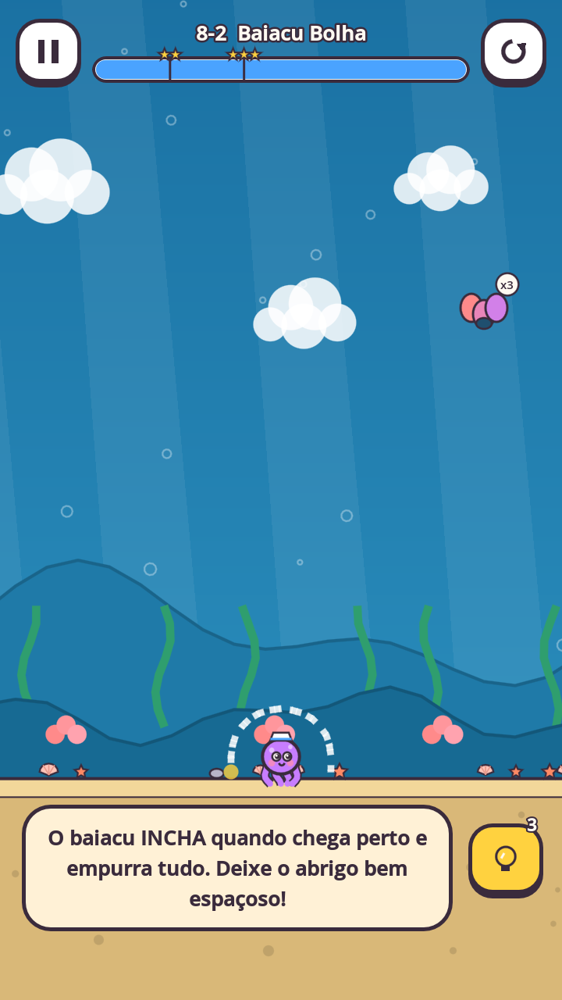

# 08 — Campanha: 60 fases em 8 mundos

**Todas as 60 fases estão implementadas** em `data/levels.json`, cada uma com solução registrada verificada pelo teste automático (ver status dos testes no doc 12).
**Estrelas:** o orçamento de tinta é calibrado para a solução registrada usar ~55 %; 3★ exige ≤ 60 %, 2★ ≤ 80 %.
Regra de ouro: **toda solução pode ser deduzida olhando a cena** — ninhos visíveis com contagem, zonas proibidas hachuradas, lâmpada com contador, plataforma com trajeto pontilhado.

## Mundo 1 — Jardim dos Bichinhos (ensina o básico)
| Fase | Cenário | Objetivo / perigos | Mecânica ensinada | Solução válida |
|---|---|---|---|---|
| ✅ 1-1 Oi, Capitu! | Gramado plano, colmeia à direita | Proteger Capitu de 5 abelhas por 6 s | Desenhar, soltar, a linha cai com peso | Arco ("abrigo") sobre a Capitu, pernas quase no chão |
| ✅ 1-2 Zumbido em Dobro | Duas colmeias, uma de cada lado | 8 abelhas de duas direções, 8 s | Abrigo fechado protege de todos os lados | Mesmo arco, bem fechado |
| ✅ 1-3 Brasa, a Curiosa | Colmeia à esquerda | 6 abelhas, 8 s; Brasa é alta | Bichinhos têm tamanhos diferentes | Arco alto e estreito |
| ✅ 1-4 Fila de Formigas | Formigueiro à esquerda, Capitu à direita | 6 formigas pelo chão, 10 s | Inseto andarilho; parede em vez de teto | Tenda "Λ" íngreme entre o formigueiro e a Capitu (gasta pouca tinta → 3★) |
| ✅ 1-5 Bolinha de Espinhos | Colmeia + formigueiro | 4 abelhas + 4 formigas, 9 s | Dois tipos de inseto juntos | Arco sobre o Pingo (resolve os dois) |
| ✅ 1-6 Lá no Alto | Galho de madeira no alto | 6 abelhas, 8 s; galho estreito | Precisão: a linha tem que pousar na plataforma | Arco pequeno cujas pernas pousam no galho |

## Mundo 2 — Floresta Encantada (frestas, luz, vários bichinhos)
| Fase | Cenário | Objetivo / perigos | Mecânica | Solução |
|---|---|---|---|---|
| ✅ 2-1 Zizi, o Mosquito | Clareira | 7 mosquitos, 8 s | Inseto que acha qualquer fresta | Arco totalmente fechado no chão |
| ✅ 2-2 Luz da Lanterna | Lanterna (4 s) à esquerda | 5 mariposas, 10 s | Isca de luz e tempo visível | Arco sobre a Brasa antes de a luz apagar |
| ✅ 2-3 Dois Amigos | Capitu e Nino lado a lado | 7 abelhas, 8 s | Vários bichinhos | Um arco largo sobre os dois |
| ✅ 2-4 Caixa Amiga | Caixa de madeira ao lado | 6 abelhas, 8 s | Objetos físicos economizam tinta | Arco sobre a Capitu; ou meia-água apoiada na caixa (3★) |
| ✅ 2-5 Duas Linhas | Pedra separa Capitu e Pingo | 8 abelhas, 9 s; **2 traços** | Mais de um traço; botão "Pronto!" | Um arco para cada |
| ✅ 2-6 Zona Proibida | Faixa listrada acima da Brasa | 8 abelhas de dois lados, 9 s | Espaço limitado para desenhar | Arco baixinho abaixo da zona |

## Mundo 3 — Vale das Formigas (abismos, empurrões, objetos móveis)
| Fase | Cenário | Objetivo / perigos | Mecânica | Solução |
|---|---|---|---|---|
| ✅ 3-1 Bolota Teimosa | Chão plano | 2 besouros pela esquerda | Inseto que empurra | Arco largo (mais tinta = mais peso) |
| ✅ 3-2 Ponte Sobre o Nada | Abismo entre formigueiro e Capitu | 8 formigas + 4 abelhas | Abismos param andarilhos | Não desenhar ponte! Só um arco contra as abelhas |
| ✅ 3-3 Ladeira do Pingo | Rampa de 15° terminando num laguinho | Pingo rola quando a simulação começa; 5 abelhas | Física do bichinho | Arco apoiado na própria rampa: segura o Pingo e o protege |
| ✅ 3-4 Elevador de Folha | Plataforma que desce e sobe | 6 abelhas; Nino sobre a plataforma | Objetos móveis | Arco apoiado na própria plataforma (move junto) |
| ✅ 3-5 Roque-Roque | Duas caixas empilhadas formam parede | 3 cupins roem a madeira + 4 formigas | Barreiras frágeis | Arco de tinta sobre a Capitu (a madeira vai cair) |
| ✅ 3-6 Formigueiro Gigante | Dois formigueiros colados na Capitu + besouro | 8 formigas + 1 besouro, 12 s | Tampar formigueiros com a própria linha | Arco com as **pontas em cima dos dois buracos** (o círculo largo deixa os buracos dentro e perde — testado) |

## Mundo 4 — Lagoa Misteriosa (água, novos amigos, vespas)
| Fase | Cenário | Objetivo / perigos | Mecânica | Solução |
|---|---|---|---|---|
| ✅ 4-1 Bolhas da Lulu | Lulu numa ilhota de pedra no meio da lagoa | 10 formigas (a água as leva) + 5 abelhas | Água leva insetos embora | Arco pequeno sobre a Lulu, na ilhota |
| ✅ 4-2 Vovó Tuca | Tuca no gramado | 6 abelhas; tinta curta | Casco aguenta 1 picada | Arco baixo e largo (o casco perdoa uma brecha) |
| ✅ 4-3 Faísca! | Vespeiro no alto à esquerda | 2 vespas | Investida telegrafada ("!") | Arco firme e mais largo (mais pesado) |
| ✅ 4-4 Fosso Protetor | Fosso com água entre o formigueiro e a Capitu | 10 formigas + 5 abelhas | Usar o cenário a favor | Arco contra as abelhas; o fosso leva as formigas |
| ✅ 4-5 Lagarta Gulosa | Gramado | 2 lagartas + 5 formigas | Inseto que escala paredes | A tenda que barrava formigas não basta: arco fechado |
| ✅ 4-6 Ilhas Amigas | Brasa na margem esquerda, Lulu na ilhota, Tuca na direita | 6 mosquitos + 1 vespa, 3 traços | Vários bichinhos e traços | Um arco para cada |

## Mundo 5 — Acampamento no Quintal (noite, luz e combinações)
| Fase | Cenário | Objetivo / perigos | Mecânica | Solução |
|---|---|---|---|---|
| ✅ 5-1 Noite de Lanternas | Lanternas de 3 s (esq.) e 7 s (dir.) | 6 mariposas, 11 s | Iscas e tempo | Só o Nino precisa de abrigo: as mariposas ficam na lanterna que dura mais e depois vão ao bichinho mais perto dela (3★ com pouca tinta) |
| ✅ 5-2 Fogueira de Brinquedo | Duas caixas soltas | 5 abelhas + 1 besouro empurrando | Objetos + empurrão | Arco largo sobre a Capitu |
| ✅ 5-3 Carrossel de Tábua | Plataforma que vai e volta na horizontal | 9 abelhas de dois lados | Plataforma horizontal | Arco sobre a Brasa, apoiado na plataforma |
| ✅ 5-4 Pouca Tinta | Bloco de pedra alto ao lado da Capitu; tinta curtíssima | 6 mosquitos | Economia extrema | Meia-água do topo do bloco até o chão (o arco completo não cabe) |
| ✅ 5-5 Todos Juntos | Os seis bichinhos | 8 abelhas + 5 mosquitos, 3 traços, 12 s | Revisão geral | Três arcos agrupando os amigos de dois em dois |
| ✅ 5-6 Rainha Zumbina | Duas colmeias + a Rainha pairando | Rajadas de vento a cada 3,2 s + 12 abelhas, 14 s | Batalha especial sem violência | Arco sobre a Capitu entre as duas pedras, que o travam contra as rajadas |

## Mundo 6 — Montanha Gelada (neve, gelo, buracos, vento)
| Fase | Bichinhos | Perigos | Mecânica | Dica no jogo | Círculo genérico perde? |
|---|---|---|---|---|---|
| ✅ 6-1 Olá, Gelinho! | Gelinho | 5 abelhas, 7 s | Novo bichinho; cenário de neve. | O Gelinho chegou escorregando da montanha. Proteja ele das abelhas! | — |
| ✅ 6-2 Buracos na Neve | Nuvem | 6 formigas, 4 abelhas, 9 s | Tampar buracos com a própria linha (um círculo folgado deixa os buracos dentro!). | Formigas vão sair dos BURACOS! Desenhe com as pontas da linha EM CIMA deles para tampar. | sim (testado) |
| ✅ 6-3 Grilos Pulões | Kiko | 4 grilos, 11 s | Inseto que pula: parede não basta. | Grilos pulam por cima de paredes! Só um abrigo com teto segura. | sim (testado) |
| ✅ 6-4 Rumo à Toca do Tatá | Tatá | levar até a toca, 10 s | Tinta Firme e objetivo de levar o bichinho até a toca. | TINTA FIRME: a linha não cai! Faça uma rampa para o Tatá rolar até a toca. | sim (testado) |
| ✅ 6-5 Teia na Caverna | Gelinho | 2 aranhas, 4 formigas, 10 s | Aranha que desce do teto. | A aranha anda pelo teto e DESCE reto. Formigas vêm pelo chão. Abrigo com teto! | sim (testado) |
| ✅ 6-6 Abelha Broca | Capitu | 3 abelhas broca, 6 s | Parede dupla contra quem fura. | A Abelha Broca FURA a linha depois de um tempinho. Dois traços = parede dupla! | sim (testado) |
| ✅ 6-7 Ventania | Nuvem | 6 abelhas, 10 s | Vento empurra linhas e insetos. | Rajadas de vento empurram a linha! Encoste o abrigo no paredão de pedra para ele não voar. | — |
| ✅ 6-8 Tobogã do Gelinho | Gelinho | 3 abelhas, 9 s | Bichinho que escorrega + objetivo. | O Gelinho escorrega no gelo! Faça um tobogã de Tinta Firme até o iglu. | sim (testado) |
| ✅ 6-9 Abrigo na Rocha | Kiko | 6 mosquitos, 9 s | Usar o cenário e economizar tinta. | Pouquíssima tinta! Use o paredão de pedra como parede e faça só um telhadinho. | — |
| ✅ 6-10 Pico Nevado | Nuvem, Gelinho | 12 formigas, 6 abelhas, 10 s | Revisão: buracos + dois traços. | Dois amigos, dois traços e buracos dos dois lados. Tampe tudo! | sim (testado) |

## Mundo 7 — Praia do Sol (tocas, coco, mel, vespas)
| Fase | Bichinhos | Perigos | Mecânica | Dica no jogo | Círculo genérico perde? |
|---|---|---|---|---|---|
| ✅ 7-1 Pompom na Praia | Pompom | 6 abelhas, 8 s | Novo bichinho; cenário de praia. | Pompom tem orelhas compridas: capriche na altura do abrigo! | — |
| ✅ 7-2 Coqueiro Traiçoeiro | Pompom | 4 abelhas, 8 s | Objetos que caem. | Um coco vai cair (veja a linha pontilhada)! Um abrigo firme aguenta o bonk. | — |
| ✅ 7-3 Caranguejos da Toca | Patinha | 4 caranguejos, 4 abelhas, 9 s | Tampar tocas (de novo, agora com caranguejos). | Caranguejos moram nos buracos da areia. Tampe os buracos com as pontas da linha! | sim (testado) |
| ✅ 7-4 Piquenique | Patinha, Pompom | 6 abelhas, 10 s | Isca de mel: quem está em perigo de verdade? | As abelhas vão PRIMEIRO no mel. Quando acabar, atacam quem estiver mais perto do pote! | sim (testado) |
| ✅ 7-5 Siri Teimoso | Fofa | 3 caranguejos, 4 abelhas, 11 s | Inseto que empurra na praia. | Caranguejos empurram com força e não têm medo de água. Abrigo largo e pesado! | — |
| ✅ 7-6 Vespas no Quiosque | Pompom | 2 vespas, 9 s | Combinação: investida + queda. | Vespas avisam com "!" antes da investida, e ainda tem coco caindo! | — |
| ✅ 7-7 Toca no Rochedo | Patinha | 7 mosquitos, 9 s | Tinta Firme como portinha. | Tinta Firme e quase nada de tinta: feche só a entrada da toca da Patinha! | sim (testado) |
| ✅ 7-8 Rumo ao Guarda-Sol | Pingo | levar até a toca, 10 s | Rampa sobre a água. | O Pingo vai rolar da duna! Faça uma rampa de Tinta Firme por cima da água até a toca. | sim (testado) |
| ✅ 7-9 Coco e Caranguejo | Patinha | 4 caranguejos, 9 s | Combinar regras. | Coco caindo E caranguejos nos buracos. Abrigo firme com as pontas nos buracos! | sim (testado) |
| ✅ 7-10 Festa na Praia | Pompom, Fofa | 4 caranguejos, 6 abelhas, 10 s | Revisão da praia. | Dois traços para dois amigos. Cuidado com as tocas e com o coco da Fofa! | sim (testado) |

## Mundo 8 — Fundo do Mar (águas-vivas, baiacus, correnteza)
| Fase | Bichinhos | Perigos | Mecânica | Dica no jogo | Círculo genérico perde? |
|---|---|---|---|---|---|
| ✅ 8-1 Olá, Tito! | Tito | 4 águas-vivas, 10 s | Novo mundo: fundo do mar. | No fundo do mar, as águas-vivas nadam devagarinho até o Tito. | — |
| ✅ 8-2 Baiacu Bolha | Tito | 3 baiacus, 10 s | Criatura que cresce. | O baiacu INCHA quando chega perto e empurra tudo. Deixe o abrigo bem espaçoso! | — |
| ✅ 8-3 Caranguejos do Fundo | Fofa | 4 caranguejos, 3 águas-vivas, 10 s | Tocas no fundo do mar. | Até no fundo do mar tem toca de caranguejo! Tampe com as pontas da linha. | sim (testado) |
| ✅ 8-4 Correnteza | Lulu | 5 águas-vivas, 11 s | Correnteza (vento submarino). | A correnteza empurra as águas-vivas e a sua linha! Apoie o abrigo na pedra. | — |
| ✅ 8-5 Toca do Polvo | Tito | 5 águas-vivas, 10 s | Usar o cenário: uma tampinha basta. | O Tito se escondeu entre as pedras. Só falta uma tampa na entrada de cima! | sim (testado) |
| ✅ 8-6 Cardume Gelatinoso | Tito, Lulu | 10 águas-vivas, 11 s | Muitas criaturas. | Muitas águas-vivas dos dois lados! Um abrigo grande para os dois amigos. | — |
| ✅ 8-7 Recife de Coral | Fofa | 2 baiacus, 4 águas-vivas, 11 s | Combinação no recife. | Baiacus E águas-vivas. Espaço para inchar e nada de frestas! | — |
| ✅ 8-8 Polvo e Caranguejo | Tito | 4 caranguejos, 2 baiacus, 10 s | Tampar + espaço. | Tocas de caranguejo e baiacu. Pontas nos buracos e abrigo espaçoso! | sim (testado) |
| ✅ 8-9 Correnteza Forte | Tito | 6 águas-vivas, 11 s | Travar o abrigo. | Correnteza fortíssima! Trave o abrigo entre as duas pedras. | — |
| ✅ 8-10 Rei dos Mares | Tito, Fofa | 4 caranguejos, 2 baiacus, 4 águas-vivas, 11 s | Revisão final. | O grande final do fundo do mar: dois traços, tocas, baiacus e águas-vivas! | sim (testado) |

   

## Como criar uma fase nova
1. Adicione uma chamada `L(...)` em `tools/make_levels.py` (funções `ground`, `block`, `animal`, `hive`, `mound`, `hole`, `holes_beside`, `coral`, `dome_over`, `wide_dome`, `slide`, `tent`; extras `winds`, `goal`, `ink_mode`, `underwater`, `naive`).
2. Rode `python3 tools/make_levels.py` → atualiza `data/levels.json`.
3. Rode os testes (`--level=ID` para só ela, `--world=N` para um mundo). O teste exige: **a solução vence**, **sem linha perde** e, se houver `naive`, **o círculo genérico perde**.
4. Ajuste `stars` para que a solução "esperta" dê 3★ e a "bruta" dê 1–2★.
