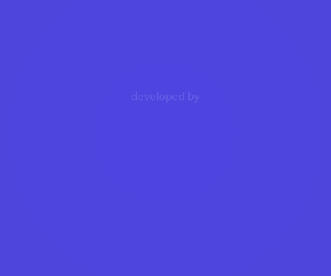

# 10 — Progressão, recompensas e acessibilidade

## Progressão (implementada)
- **Fases em sequência:** vencer libera a próxima. Mundos aparecem no mapa conforme as fases existem. **Nenhuma barreira de estrelas ou pagamento** para avançar.
- **Estrelas (1–3) por economia de tinta**, com as metas visíveis na barra antes de desenhar. Vencer sempre dá pelo menos 1★.
- **Moedas:** +10 por estrela nova, +3 por vitória, +5 no primeiro 3★. Repetir uma fase já perfeita dá só +3 → sem incentivo a "farmar".
- **Amigos:** cada bichinho salvo pela primeira vez entra na Coleção com ficha e história.
- **Guarda-roupa:** 9 acessórios cosméticos (60–250 moedas: boné, laço, óculos, chapéu de palha, presilha estrela-do-mar, coroa de flores, cachecol, touca, coroa dourada) para qualquer bichinho conhecido.
- **Modo Livre:** depois de vencer uma fase (ganhar estrela), o botão **Livre** dá **tinta infinita** para o jogador fazer o que quiser, sem mexer nas estrelas.
- **Medalhas extras por fase** (cada uma +5 moedas, uma vez): **Pegada Dourada** — passe a linha pela pegada que brilha no cenário (ela fica sempre no caminho de uma solução possível, o teste confere em todas as fases); **De Primeira** — vença sem nenhuma derrota naquela fase; **Relâmpago** — termine o desenho em até 6 s. Aparecem no mapa (em cima de cada fase) e na vitória.
- **Desafio do Dia** (`src/core/daily.gd`): uma fase já liberada + uma regra especial sorteada pela data (Tinta Curta, Enxame, Hora Extra, Tinta Firme, Pressa). Prêmio de 30 moedas, +5 por dia de sequência (até 60), contagem regressiva para o próximo. Funciona sem internet. Todas as combinações fase × regra foram testadas (`--daily-all`); as 3 impossíveis ficam fora do sorteio.
- **Álbum de fotos:** a câmera na tela de vitória guarda a cena (até 40 fotos, só no aparelho); as últimas aparecem em molduras na Casinha.
- **Casinha da Turma:** os amigos salvos passeiam pela sala com os acessórios; toque = carinho (pulinho, coração e a voz do bichinho); "Petisco" chama todo mundo.
- **Editor de fases ("Criar"):** até 12 fases próprias; escolha o cenário, o tempo, a tinta e os traços; toque para pôr bichinhos, colmeias, mosquitos, formigueiros, besouros, pedras e blocos; "Testar" joga a fase e, vencendo, ela ganha o selo de testada.
- **Conquistas: 57**, em `Game.ACHIEVEMENT_LIST` (condições em `_achievement_checks()`):
  - vitórias (1, 10, 50) e sequências sem perder (5, 15);
  - estrelas (10, 30, 60, 100, 150) e fases perfeitas (5, 15, 30);
  - economia (≤ 25 % e ≤ 15 % da tinta);
  - um troféu por mundo (8) e a Rainha Zumbina;
  - amigos (6, 10, 14 bichinhos);
  - guarda-roupa (equipar, 3 itens, todos) e cofrinho (500 moedas);
  - mecânicas novas: **Tampa-Buracos** (5 buracos tampados), **Entrega Fofa** (3 tocas), **Artista Livre** (vencer no Modo Livre);
  - persistência: dica, 100/500 linhas, tentar de novo 10/50 vezes;
  - chefões (Coruja, Caranguejo Rei, Polvo, os quatro), medalhas (10/30 pegadas, 10 de primeira, 10 relâmpagos, 10 triplas), Desafio do Dia (1, 7, 3 e 7 dias seguidos), editor (1 e 5 fases testadas), fotos (1, 10) e carinho (20).
- **Dicas opcionais:** começa com 3; trocar 40 moedas por +1. A dica mostra a solução tracejada animada. **Paga uma vez por fase na sessão** (recomeçar não cobra de novo). Disponível também na tela de derrota.

## Abertura
Ao abrir o app aparece a abertura com o **logo oficial da RetroNexa** (~6 s, toque para pular): fundo índigo `#4E45DC`, "RetroNexa" em branco com um buraco no lugar do "o"; o **Pingo** entra rolando enroladinho, pula de letra em letra (cada uma amassa e balança), cai no buraco e **vira o "o"** — desenrola, sorri, e o site aparece. (Inspirada no estilo das aberturas de estúdio, mas original: personagem e movimento próprios.) Com "Reduzir movimento", o Pingo já aparece no lugar.

Detalhes do logo: **"desenvolvido por"** em cima e **retronexa.com.br** embaixo, com jingle próprio (`src/ui/splash_screen.gd`). O logo foi redesenhado em alta resolução a partir da imagem enviada (fonte Inter, licença OFL, recortada para ~35 KB): `assets/brand/retronexa_logo.png` e `retronexa_logo_site.png`, gerados por `tools/make_brand.py`.

## Ética de design (anti-manipulação)
- Sem vidas/energia, sem tempo de espera, sem roleta, sem caixas surpresa, sem contagem regressiva de ofertas.
- Sem "quase ganhou, pague para continuar".
- Moedas só se ganham jogando (enquanto não houver loja); preços sempre visíveis; nada aleatório.
- Mensagens de derrota **ensinam** (ex.: "os insetos deslizam pela linha até achar uma brecha").

## Acessibilidade (implementada)
| Recurso | Como |
|---|---|
| Cores distinguíveis | Perigo/proteção/vitória também diferem em forma; insetos com padrões |
| Alto contraste | Anel vermelho em volta de cada inseto (Ajustes) |
| Reduzir movimento | Sem tremor de câmera, menos partículas, sem pulos amplos |
| Sem dependência de áudio | Todo som tem equivalente visual; legenda do cronômetro |
| Textos legíveis | ≥ 21 px na resolução de projeto, contorno em todo texto sobre cenário |
| Controles simples | Um gesto; botões ≥ 84 px; toque acidental curto é ignorado |
| Volumes separados | Música e efeitos; vibração opcional |
| Pausa automática | Ao minimizar o app |
| **Idiomas** | Português, inglês e espanhol (`data/i18n/translations.csv`, 510 textos); segue o idioma do aparelho ou o escolhido nos Ajustes |
| **Texto grande** | Ajustes → +15 % em todos os textos da interface |
| **Daltonismo** | Ajustes → correção de cores na tela inteira para protanopia, deuteranopia ou tritanopia (shader "daltonize", `src/core/daltonize.gdshader`) |

## Próximos passos de acessibilidade
Modo "sem cronômetro visível" (só barra), suporte a leitor de tela nos menus (AccessKit no Godot 4.5+), mais idiomas.
