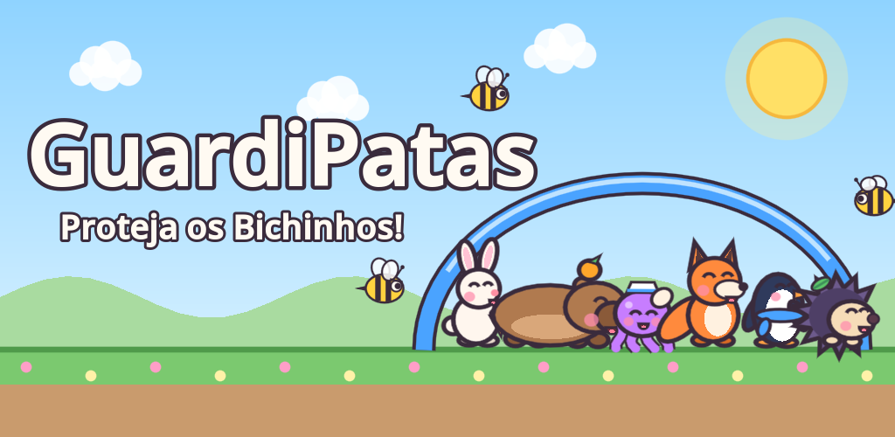
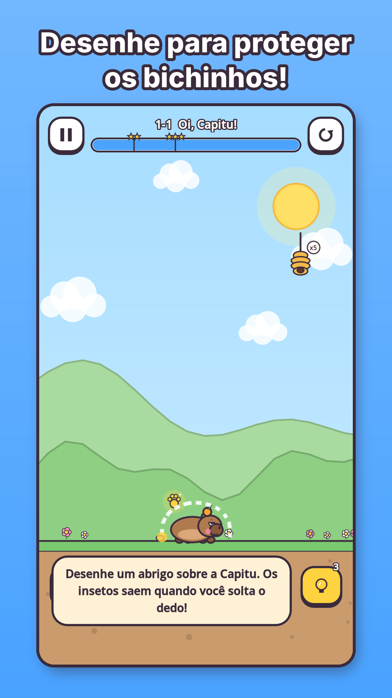
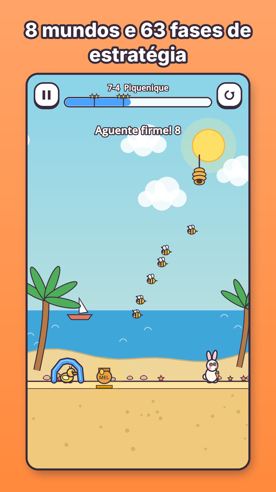
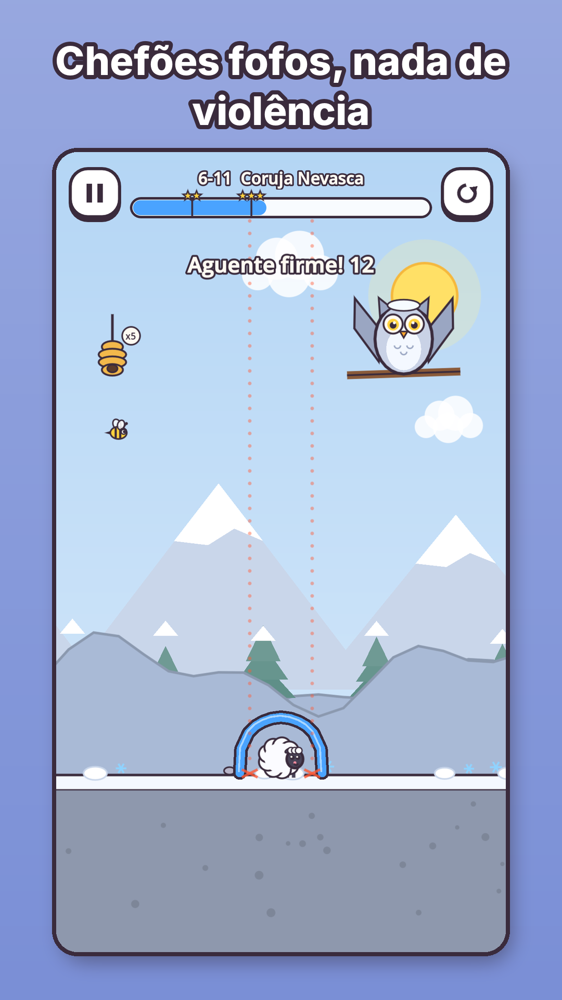
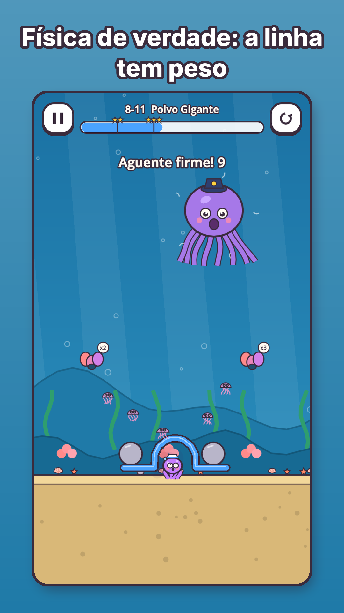
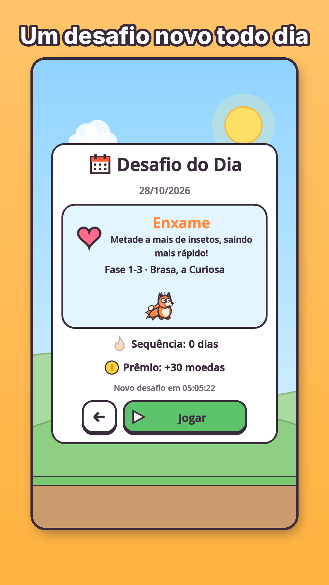
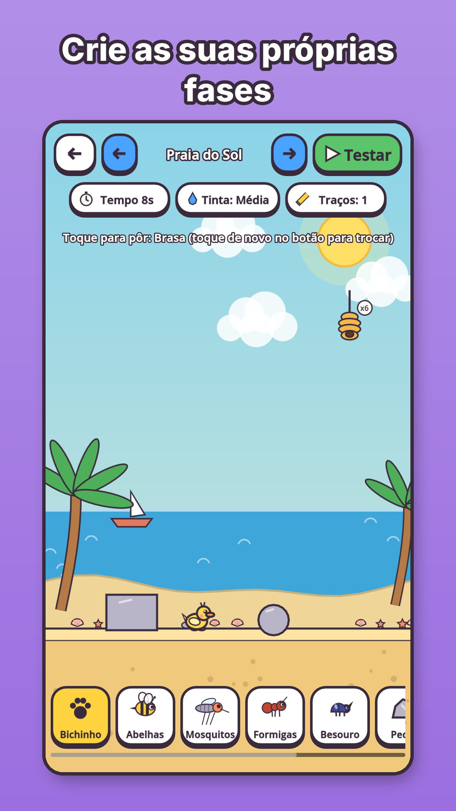
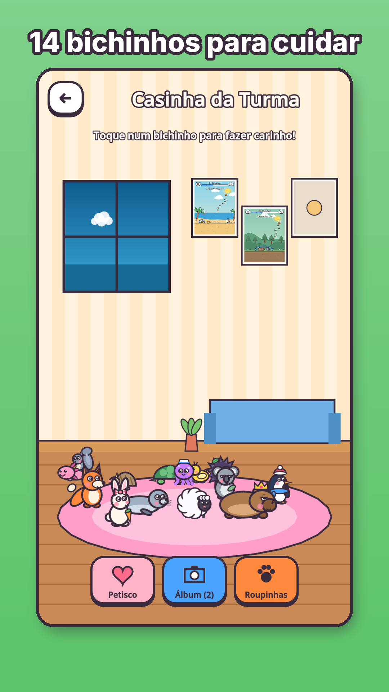

# 15 — Loja (Google Play): textos, imagens e formulários

Tudo o que a Play Console pede para publicar, pronto para copiar. Imagens em `store/` (geradas pelo próprio jogo — ver o fim deste documento).

## Imagens
| Item | Arquivo | Tamanho |
|---|---|---|
| Ícone (alta resolução) | `assets/icon/icon_512.png` | 512×512 |
| Ícone adaptativo do Android | `assets/icon/adaptive_fg.png` + `adaptive_bg.png` (+ `adaptive_mono.png`) | 432×432 |
| Imagem de destaque | `store/feature_graphic_pt.png` · `_en.png` · `_es.png` | 1024×500 |
| Capturas do celular (7 por idioma) | `store/screenshots/pt/01..07.png` · `en/` · `es/` | 1080×1920 |



      

## Ficha da loja

### Português (Brasil) — idioma principal
- **Nome do app (≤ 30):** `GuardiPatas: Salve os Bichos`
- **Descrição curta (≤ 80):** `Desenhe abrigos e proteja bichinhos fofos dos insetos travessos!`
- **Descrição completa:**

> Os insetos travessos estão chegando… e só você pode proteger a turma! 🐾
>
> No **GuardiPatas**, você desenha uma linha com o dedo e ela vira um abrigo de verdade, com peso e física. Solte o dedo, os insetos saem dos ninhos — e o seu abrigo precisa aguentar até o tempo acabar.
>
> **63 fases de estratégia em 8 mundos:** Jardim, Floresta, Vale das Formigas, Lagoa, Acampamento, Montanha Gelada, Praia do Sol e Fundo do Mar. Tampe buracos de formigas, faça rampas de Tinta Firme, desvie de cocos, use iscas de mel e trave o abrigo contra o vento e a correnteza.
>
> **14 bichinhos fofos** — cada um com seu jeito e seu susto: Capitu, a capivara zen; Brasa, a raposa curiosa; Pingo, o ouriço que rola; Gelinho, o pinguim que escorrega; Tito, o polvo marinheiro… e muitos outros!
>
> **4 chefões sem violência:** a Rainha Zumbina, a Coruja Nevasca, o Caranguejo Rei e o Polvo Gigante.
>
> **E ainda:** Desafio do Dia, medalhas extras (Pegada Dourada, De Primeira, Relâmpago), 57 conquistas, guarda-roupa de acessórios, Casinha da Turma, Álbum de fotos das vitórias, Modo Livre com tinta infinita e **editor para criar as suas próprias fases**.
>
> Feito para todas as idades: sem anúncios, sem compras, sem coleta de dados, funciona sem internet. Em português, inglês e espanhol, com opções de acessibilidade (texto grande, correção de cores para daltonismo, reduzir movimento e alto contraste).
>
> Desenvolvido por RetroNexa — retronexa.com.br

### English
- **App name:** `GuardiPatas: Save the Critters`
- **Short description:** `Draw shelters and protect cute critters from mischievous bugs!`
- **Full description:**

> The mischievous bugs are coming… and only you can protect the gang! 🐾
>
> In **GuardiPatas**, you draw a line with your finger and it becomes a real shelter, with weight and physics. Lift your finger, the bugs leave their nests — and your shelter has to hold until time runs out.
>
> **63 strategy levels across 8 worlds:** Garden, Forest, Ant Valley, Pond, Campout, Frosty Mountain, Sunny Beach and Deep Sea. Plug ant holes, build Firm Ink ramps, dodge coconuts, use honey as bait and wedge your shelter against wind and currents.
>
> **14 cute critters**, each with its own personality and way of getting scared: Capitu the zen capybara, Brasa the curious fox, Pingo the rolling hedgehog, Gelinho the sliding penguin, Tito the sailor octopus… and many more!
>
> **4 bosses, zero violence:** Queen Buzzina, the Blizzard Owl, King Crab and the Giant Octopus.
>
> **Plus:** Daily Challenge, bonus medals (Golden Paw, First Try, Lightning), 57 achievements, an accessory wardrobe, the Gang's Cottage, a victory Photo Album, Free Mode with infinite ink and a **level editor to create your own levels**.
>
> Made for all ages: no ads, no purchases, no data collection, works offline. In English, Portuguese and Spanish, with accessibility options (large text, color-blindness correction, reduced motion and high contrast).
>
> Developed by RetroNexa — retronexa.com.br

### Español (Latinoamérica)
- **Nombre:** `GuardiPatas: Salva Animalitos`
- **Descripción breve:** `¡Dibuja refugios y protege a animalitos tiernos de insectos traviesos!`
- **Descripción completa:**

> Los insectos traviesos están llegando… ¡y solo tú puedes proteger a la pandilla! 🐾
>
> En **GuardiPatas**, dibujas una línea con el dedo y se convierte en un refugio de verdad, con peso y física. Levanta el dedo, los insectos salen de sus nidos, y tu refugio tiene que aguantar hasta que se acabe el tiempo.
>
> **63 niveles de estrategia en 8 mundos:** Jardín, Bosque, Valle de las Hormigas, Laguna, Campamento, Montaña Helada, Playa del Sol y Fondo del Mar. Tapa agujeros de hormigas, haz rampas de Tinta Firme, esquiva cocos, usa miel como carnada y traba el refugio contra el viento y la corriente.
>
> **14 animalitos tiernos**, cada uno con su forma de ser y de asustarse: Capitu, la capibara zen; Brasa, la zorra curiosa; Pingo, el erizo que rueda; Gelinho, el pingüino que resbala; Tito, el pulpo marinero… ¡y muchos más!
>
> **4 jefes sin violencia:** la Reina Zumbina, el Búho Ventisca, el Rey Cangrejo y el Pulpo Gigante.
>
> **Además:** Desafío del Día, medallas extra (Huella Dorada, A la Primera, Relámpago), 57 logros, armario de accesorios, la Casita de la Pandilla, Álbum de fotos de las victorias, Modo Libre con tinta infinita y un **editor para crear tus propios niveles**.
>
> Para todas las edades: sin anuncios, sin compras, sin recopilación de datos y funciona sin internet. En español, portugués e inglés, con opciones de accesibilidad (texto grande, corrección de color para daltonismo, reducir movimiento y alto contraste).
>
> Desarrollado por RetroNexa — retronexa.com.br

## Categoria, público e formulários
| Campo | Resposta |
|---|---|
| Tipo / categoria | Jogo · Quebra-cabeça (Puzzle) |
| Tags sugeridas | Quebra-cabeça de física, Desenho, Fofo, Casual, Animais |
| Público-alvo | Todas as idades (inclui menores de 13 — programa **Projetado para Famílias**) |
| Anúncios | **Não contém anúncios** |
| Compras no app | Nenhuma |
| Classificação (IARC) | Sem violência (os insetos não se machucam: desistem e vão embora), sem linguagem imprópria, sem medo intenso, sem jogos de azar, sem interação entre usuários, sem compartilhamento de localização → esperado **Livre / PEGI 3 / Everyone** |
| Segurança dos dados | **Nenhum dado coletado e nenhum dado compartilhado.** O progresso, as fotos do Álbum e as fases do editor ficam só no aparelho (`user://`). Sem conta, sem internet. |
| Permissões | Vibração (opcional, nos Ajustes). Nenhuma outra. |
| Política de privacidade | Texto pronto em [privacidade.md](privacidade.md) — publique numa página (ex.: `retronexa.com.br/guardipatas/privacidade`) e cole o link na Play Console. |
| Contato | e-mail de suporte da RetroNexa (preencher na Console) |

## Como regenerar as imagens
```bash
# destaque 1024×500 (3 idiomas)
xvfb-run -a -s "-screen 0 1280x1280x24" godot --path . --rendering-driver opengl3 --audio-driver Dummy res://tools/store_render.tscn
# capturas cruas 1080×1920 por idioma, depois molduras com legenda
for L in pt_BR en es; do
  xvfb-run -a -s "-screen 0 1080x1920x24" godot --path . --rendering-driver opengl3 --resolution 1080x1920 --audio-driver Dummy res://tests/screenshots.tscn -- --out=/tmp/loja/$L --ui --lang=$L
  xvfb-run -a -s "-screen 0 1080x1920x24" godot --path . --rendering-driver opengl3 --resolution 1080x1920 --audio-driver Dummy res://tests/screenshots.tscn -- --out=/tmp/loja/$L --lang=$L --shots=6-11:solve:1.6,8-11:solve:3.0,7-4:solve:2.5
done
python3 tools/store_frames.py /tmp/loja
# ícones
xvfb-run -a godot --path . --rendering-driver opengl3 --audio-driver Dummy res://tools/icon_render.tscn
```
