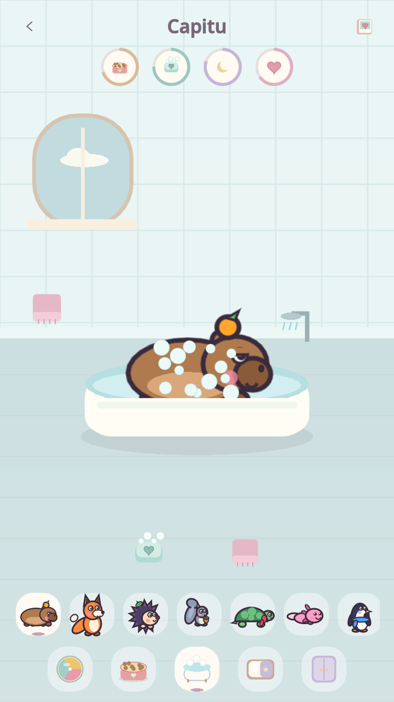
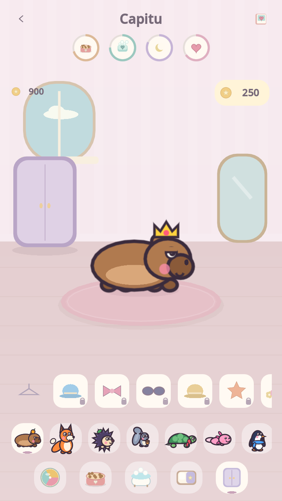

# Casinha: ambientes e cuidados visuais

A Casinha 0.4.1 tem cinco ambientes ilustrados com arte própria do GuardiPatas. Um amigo fica em destaque, com um carrossel de retratos para trocar de bichinho. Os animais resgatados e os companheiros adquiridos aparecem juntos; antes do primeiro resgate, a Capitu já está disponível.

<p>
  
</p>

Capturas reais do Godot no desktop. Os objetos substituem os antigos painéis, seletores de texto e botões com legendas. As necessidades aparecem em quatro pequenos indicadores circulares: comida, higiene, energia e carinho. Toque prolongado/mouse sobre os indicadores revela nome e percentual.

## Como brincar

- **Sala (bola no rodapé):** toque na bola ou segure, arraste e solte para lançar. Ela tem gravidade, rotação, colisão com as paredes e quique; o bichinho acompanha a brincadeira. Toque no amigo para fazer carinho.
- **Cozinha (pratinho):** toque na refeição, maçã ou biscoito para alimentar; também pode arrastar o alimento até o bichinho. Soltar fora dele cancela. Uma barriguinha cheia não recebe mais comida.
- **Banheiro (banheira):** arraste o sabão sobre o amigo para fazer espuma. Também pode selecionar o sabão e dar quatro toques no bichinho. Quando houver espuma suficiente, o chuveiro ganha um brilho: toque para enxaguar. A toalha seca depois. Sabão sozinho não conclui o banho.
- **Quarto (caminha):** toque na cama ou luminária para dormir ou acordar. O ambiente escurece, os olhos fecham e a energia se recupera enquanto a Casinha estiver aberta.
- **Guarda-roupa (armário):** deslize pelos acessórios ilustrados. Um cadeado indica item ainda não adquirido. Toque para experimentar sem gastar; uma ficha com moeda e preço permite confirmar a compra. O saldo aparece separado. Itens adquiridos vestem com um toque; o cabide vazio tira o acessório. Trocar de ambiente/bichinho ou sair desfaz a prévia.
- **Retratos:** deslize a fileira para encontrar todos os amigos. O livro no topo abre o Álbum; a seta retorna ao menu.

Os cuidados e alimentos são gratuitos e ilimitados. Somente roupas custam moedas do jogo. Não há anúncios, cobrança real, remédios, morte, doença, perda de animais ou penalidade por deixar de jogar. Cuidar não gera moedas nem altera a dificuldade das fases.

## Progresso e persistência

- Necessidades e sono são individuais, guardados em `care` no save ativo. Saves anteriores recebem os valores iniciais ao usar o recurso.
- As necessidades só avançam com a Casinha aberta. Não há deterioração offline; uma pausa longa de frame é limitada a dois segundos de simulação.
- Ações são salvas imediatamente. O avanço passivo é salvo a cada 15 segundos, ao sair e ao minimizar. Encerramento forçado pode perder até esse intervalo de avanço passivo.
- Falhas de gravação revertem o cuidado, a compra ou a troca de roupa, com um aviso curto.
- A simulação de compras usa save separado. Apagar progresso limpa os cuidados do modo ativo.
- Bichinhos dormindo não comem nem brincam. Espuma e estado da bola são efeitos de sessão; trocar de bichinho limpa a espuma.

## Layout, controles e testes

O cenário e os objetos se reorganizam conforme a área útil, incluindo a área segura do Android. Os carrosséis permitem acessar todos os retratos e acessórios sem amontoar controles. Objetos têm áreas de toque, dicas traduzidas para português/inglês/espanhol e foco visível para teclado; os carrosséis acompanham o foco. O banho também funciona só com toques. Reduzir movimento desliga o deslocamento dos corações, as nuvens, os pulos e a chuva animada; lançar a bola continua sendo uma interação física.

Testes com Godot 4.7.2, a partir da raiz:

```bash
godot --headless --fixed-fps 60 --path . res://tests/home_visual_test.tscn
godot --headless --path . res://tests/pet_care_test.tscn
```

Para incluir persistência e falhas de gravação no segundo teste, use `-- --test-io` e `XDG_DATA_HOME` terminado em `/guardipatas-care-tests`. Essa restrição evita apagar progresso pessoal.

Validação desta interface:

- 53 verificações de gestos e layout: entrada real pela GUI, alimentação sem duplicar, arraste cancelado, teclado, banho, cama, contraste noturno, roupas, lançamento/gravidade/quique e objetos dentro da tela nos cinco ambientes. Tamanhos: 360×640, 720×1280, 720×1600, 1024×1366 e 1280×720.
- 48 verificações de cuidados, 52 de loja e fluxo completo da interface aprovados; 81 scripts compilados sem erros.
- Renderização desktop inspecionada com OpenGL Compatibility/Mesa, incluindo telas pequenas, tablet e paisagem. O CI inclui os testes de gestos/layout e persistência.
- Toque e desempenho em aparelho Android e a execução remota do CI ainda precisam ser verificados. Há avisos de recursos de áudio no encerramento de alguns testes, já observados antes desta interface.
