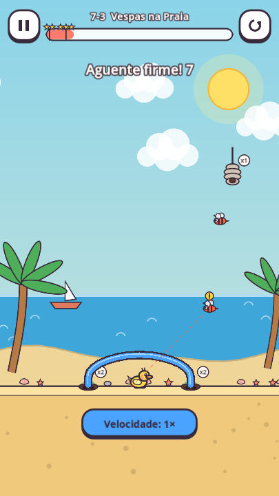
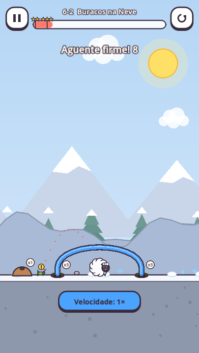
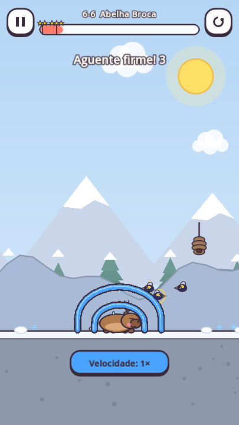

# Insetos com novas táticas — 0.5.0

Os inimigos passam a explorar a defesa, além de ganhar pequenos aumentos de força e controle. A resposta é planejar apoios, entradas, teto e camadas conforme as espécies que saem dos ninhos. Não há ataques disparados durante o desenho.

<p>
  
</p>

Capturas reais do jogo renderizado pelo Godot.

## Comportamentos

| Ameaça | O que mudou | Como responder |
|---|---|---|
| Abelhas e mosquitos | Procuram desvios nas pontas das linhas e nos cantos das pedras; avaliam a folga para o corpo. Preferem um amigo exposto quando a alternativa está protegida. Mantêm o alvo até haver uma vantagem clara em trocar. | Fechar frestas e proteger os amigos que compartilham o cenário. |
| Besouros e caranguejos | Ao encostar em tinta ou madeira solta, preparam um golpe durante 0,65 s. O anel e o sinal de aviso precedem o impulso no ponto de contato; há 2,1 s de intervalo entre golpes. | Apoiar ou travar o abrigo. Pedra e Tinta Firme não são deslocadas. |
| Vespas | Voo de aproximação mais forte e investida a 850 px/s. A linha pontilhada mostra a direção; a mira antecipa um pouco o movimento do amigo e trava nos últimos 0,25 s do aviso de 0,7 s. Depois do impacto, há recuperação de 0,9 s. | Antecipar o ângulo do impacto e apoiar a linha. Um alvo em movimento pode sair da mira travada. |
| Grilos | Identificam parede, beirada ou amigo elevado; não pulam periodicamente em chão livre. Preparam o salto durante 0,3 s, com trajetória pontilhada. | Usar teto; uma parede baixa isolada pode ser superada. |
| Aranhas | Avisam antes de descer. Se o teto bloquear por 0,5 s, recolhem o fio, mudam a posição e tentam outra lateral. Mantêm a nova descida até passar da altura que as bloqueou. | Proteger também as laterais do teto; uma cobertura curta deixa outras entradas. |
| Brocas e baiacus-broca | Mostram um anel de progresso enquanto perfuram. Cada corpo de traço continua exigindo 2,2 s de contato acumulado. | Tampar as tocas ou separar duas camadas com espaço entre elas. |
| Baiacus | Também inflam ao pressionar tinta ou madeira, mesmo longe do amigo. Mantêm a pressão por um breve intervalo após perder contato, evitando inflar/murchar a cada frame. | Abrigo com espaço e apoio; inflar não permite atravessar tinta. |
| Águas-vivas | Pulsos direcionados por uma rota com desvio, antecipando um pouco o movimento do alvo. O impulso deixa de escolher um ângulo aleatório. | Fechar entradas e usar o cenário para conter o avanço. |
| Mariposas | Contornam obstáculos na aproximação à luz. Continuam orbitando a lâmpada enquanto ela estiver acesa. | Usar o tempo da luz e proteger o amigo que ficará próximo quando ela apagar. |
| Formigas e lagartas | Avanço mais rápido; continuam limitadas ao seu tipo de movimento. | Formigas não voam nem sobem paredes íngremes; lagartas escalam, mas precisam contornar fisicamente o abrigo. |

Mel e luz continuam sendo iscas: prevalecem sobre a escolha de um alvo exposto. Ao terminar a isca, o inseto se fixa no amigo mais próximo daquele ponto. Essa memória preserva a estratégia das fases de prioridades, em vez de redirecionar imediatamente o enxame para o outro lado da tela.

## Campanha

Cinco fases combinam essas habilidades com os desafios existentes, sem mudar tinta, tempo, geometria ou soluções:

- 4-2: lagartas, mosquitos e brocas nos apoios.
- 6-2: grilos e tocas de broca na neve.
- 6-7: aranhas, mosquitos e uma broca no apoio.
- 7-3, **Vespas na Praia**: investidas e tocas de broca.
- 7-6: caranguejos golpeando, mosquitos e broca no apoio.

Os dois tutoriais continuam introdutórios. Progresso, estrelas e compras já existentes são mantidos. A exportação passa a 0.5.0 / versionCode 4.

## Física e previsibilidade

A navegação consulta obstáculos em intervalos de pelo menos 0,22 s, guarda o desvio e reduz a velocidade perto dos cantos. Considera vértices côncavos para reconhecer a entrada de uma caverna. Não teleporta os insetos, não desloca o alvo e não desliga colisões para criar uma passagem. A perfuração por corpo de traço mantém a regra anterior das brocas.

Cada nascimento recebe uma identidade crescente na tentativa. Fases de voo, desempate de rotas, deslocamento e leque de saída do ninho passam a depender dessa identidade e da posição do ninho, sem usar o sorteio global. O RNG visual/sonoro continua livre. Essa previsibilidade ajuda a aprender com a derrota.

Avisos aparecem durante a preparação e são cancelados ao atordoar ou encerrar a fase. Com Reduzir movimento, o sinal de exclamação fica contínuo. A velocidade 2× mantém o mesmo passo da física e acelera o tempo exibido e os avisos juntos.

## Validação

Com Godot 4.7.2, na raiz:

```bash
godot --headless --fixed-fps 60 --path . res://tests/insect_tactics_test.tscn
godot --headless --fixed-fps 60 --path . res://tests/test_runner.tscn
godot --headless --fixed-fps 60 --path . res://tests/strategy_test.tscn
godot --headless --fixed-fps 60 --path . res://tests/test_runner.tscn -- --daily-all
godot --headless --fixed-fps 60 --path . res://tests/speed_test.tscn
```

O teste de táticas usa física real: contornar uma pedra, atravessar uma fresta, respeitar abrigo fechado, entrar em uma caverna côncava, priorizar alvo/isca, avisar e travar a mira, golpear tinta solta, respeitar Tinta Firme, saltar um obstáculo, tentar outra descida, perfurar camadas separadamente, inflar sob pressão e repetir trajetória com outro RNG global. O CI inclui essa suíte.

A renderização é inspecionada no desktop com OpenGL Compatibility/Mesa. A validação automática não substitui testes de toque, desempenho e balanceamento em aparelhos Android. Há avisos conhecidos de recursos de áudio no encerramento de algumas suítes.

Resultado local com a implementação final:

- 25 verificações de táticas com física real aprovadas.
- 410 verificações da campanha, incluindo vitória com solução e derrota sem desenho nas 63 fases, aprovadas.
- 270 verificações obrigatórias contra padrões genéricos nas 54 fases estratégicas, aprovadas. Alternativas válidas nas fases de tutorial, iscas e cenários específicos continuam permitidas.
- 202 combinações de desafios diários aprovadas.
- 37 verificações de velocidade 1×/2× e o fluxo completo da interface aprovados.
- 83 scripts compilados sem erro; JSON reproduzido pelo gerador; `git diff --check` aprovado.
- Avisos de vespa, grilo, aranha, besouro, broca e baiacu inspecionados na renderização desktop. Execução remota do CI e testes Android continuam pendentes.
