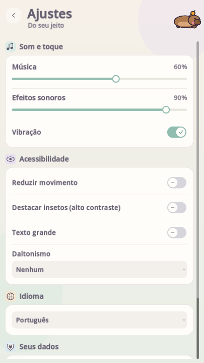
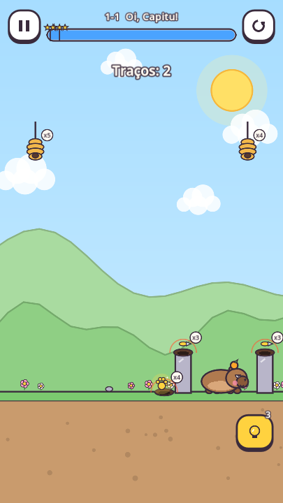

# Planejamento e configurações — 0.6.0

O menu de configurações usa cartões de som e toque, acessibilidade, idioma e dados. Interruptores indicam o estado com símbolo além da cor; volume mostra percentual; seletores abrem uma lista de opções. O conteúdo rola em telas pequenas, o texto grande é preservado e a confirmação de exclusão continua obrigatória. Voltar, inclusive no Android, cancela primeiro a confirmação.

 

As 63 fases passam por uma revisão de orçamento e todas entram nas verificações obrigatórias contra círculos e arcos genéricos. As duas primeiras já exigem planejamento de apoios e distribuição de traços. As fases de resgate exigem sustentar a chegada por 0,65 s. A tinta da solução usa aproximadamente 90% do orçamento, preservando folga para desenho manual.

46 fases acrescentam uma saída de brocas que deve ser fechada separadamente do abrigo principal. A saída é visível antes de desenhar, e o orçamento/quantidade de traços incluem sua proteção. Isso pede reservar tinta para fechar a saída e considerar a ameaça externa. A posição é escolhida respeitando animais, terreno, rochas e os outros traços; nas plataformas móveis, a saída acompanha a plataforma. As plataformas receberam mais área útil para a decisão de proteger a saída; a ilha de 4-1 foi alargada para apoiar a proteção. A correnteza de 8-9 exige uma linha com pontas presas sob as pedras.

Preservamos resgates, água, iscas de luz/mel, camadas, entradas laterais, apoios e chefões. Não há derrota por reconhecer o formato desenhado nem exigência de copiar uma linha exata. Outra solução física continua válida. Necessidades dos bichinhos, compras e progresso anteriores não são apagados.

## Validação

- `tests/settings_visual_test.tscn`: estado dos interruptores, toque, volume, cancelar exclusão e layout em PT/EN/ES com texto grande, nas proporções 360×640, 720×1280 e 1280×720.
- `tests/test_runner.tscn`: soluções das 63 fases, perda sem desenho, pegadas, traduções, progresso e amostra de desafios diários.
- `tests/strategy_test.tscn`: cinco padrões genéricos obrigatórios em todas as 63 fases. `--extended` acrescenta diagnósticos de paredes, teto curto e arcos largos/duplos; `--omissions` testa a retirada de um traço; `--level=ID` filtra uma fase. Não é prova contra todo desenho possível.
- `tests/test_runner.tscn -- --daily-all`: todas as combinações elegíveis de desafios diários.
- `tests/flow_test.tscn` e `tests/speed_test.tscn`: fluxo da interface e consistência 1×/2×.

Captura real renderizada pelo Godot no desktop com OpenGL Compatibility/Mesa. Testes e balanceamento em aparelhos Android continuam necessários. Algumas suítes ainda emitem avisos conhecidos de recursos de áudio ao encerrar.

Resultado local: 410 verificações da campanha, 315 negativas contra padrões genéricos nas 63 fases, 200 combinações diárias, 104 verificações das configurações, 37 de velocidade e fluxo completo da interface aprovados. 84 scripts compilados sem erros. JSON reproduzido pelo gerador e `git diff --check` aprovados. A versão Android passa a 0.6.0 / versionCode 5; o CI remoto ainda não foi acompanhado nesta sessão.
