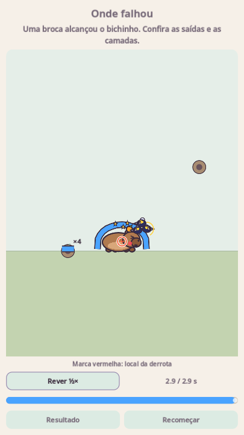

# Revisão visual das tentativas — 0.6.1

Depois de uma derrota, **Ver onde falhou** abre o registro dos últimos três segundos disponíveis. A marca em forma de mira indica o local da derrota, e a mensagem descreve o evento observado: contato com inseto, broca, queda, água, impacto, falta de tempo ou aproximação ao polvo.



A revisão começa parada no último instante. **Rever ½×** reproduz em câmera lenta; o controle deslizante permite escolher qualquer momento. **Resultado** retorna à tela da derrota e **Recomeçar** inicia uma tentativa nova. Voltar no Android ou Escape também fecha a revisão. Ela é opcional e gratuita, sem gastar moedas ou dicas, e funciona na campanha, nos desafios e no editor.

A marca aponta para onde ocorreu o evento; não identifica automaticamente uma fresta nem avalia se o desenho se parece com uma solução cadastrada. Quando acaba o tempo, aponta para a toca de destino; em quedas fora do enquadramento, fica na borda do quadro. A mensagem orienta o que observar, sem desenhar uma resposta pronta.

## Implementação e limites

O registro usa valores de posições, rotações, formas, estado de atores, luzes, saídas, tiros e vento, com aproximadamente dez amostras por segundo e até 32 quadros, limitados à janela de três segundos. Interpolação visual suaviza a reprodução entre as amostras. O enquadramento aproxima a região do evento.

É uma reconstrução ilustrada, não um vídeo: os bichinhos, insetos e chefões usam sua arte procedural; cenário e objetos são representados por formas simplificadas. Não reproduz áudio, partículas decorativas nem todos os efeitos do cenário. O histórico fica somente na memória da tentativa, não contém referências aos corpos físicos e não é salvo nem enviado.

A reprodução cria uma cena visual separada. O mundo fica pausado enquanto ela está aberta; voltar, recomeçar ou sair restaura a pausa anterior. Os atores da revisão não têm corpos de colisão; chefões ficam com processamento desabilitado. Não se refaz a física, não se alteram vitória/derrota ou recompensas, e os parâmetros de velocidade 1×/2× permanecem intactos. Reduzir movimento é respeitado pela abertura sem reprodução automática.

A coleta ocorre apenas nas fases com interface. As simulações headless sem HUD não alocam o histórico. A vitória libera os quadros. A versão Android passa a 0.6.1 / versionCode 6.

## Validação

Com Godot 4.7.2, a partir da raiz:

```bash
godot --headless --fixed-fps 60 --path . res://tests/replay_test.tscn
godot --headless --fixed-fps 60 --path . res://tests/speed_test.tscn
godot --headless --fixed-fps 60 --path . res://tests/flow_test.tscn
godot --headless --fixed-fps 60 --path . res://tests/test_runner.tscn
```

- 28 verificações da revisão: perda por contato real, local do evento, explicação correspondente à broca, buffer limitado, interpolação, imutabilidade do registro, controles reais da GUI, câmera lenta, busca no histórico, moedas/dicas/progresso preservados, voltar/recomeçar/sair, pausa anterior, arte dos chefões sem simulação e descarte do histórico ao vencer.
- Layout verificado em 360×640, 720×1280 e 1280×720, incluindo inglês e espanhol com texto grande.
- 410 verificações da campanha, 37 de velocidade e fluxo completo da interface aprovados. 87 scripts compilados sem erros.
- Capturas reais inspecionadas no desktop com OpenGL Compatibility/Mesa. Testes em aparelhos Android e execução remota do CI continuam pendentes. Persistem avisos conhecidos de recursos de áudio no encerramento de algumas suítes.

A contagem das saídas adicionais documentada na versão 0.6 foi corrigida para 50, conforme os dados gerados; esta entrega não muda as fases.
